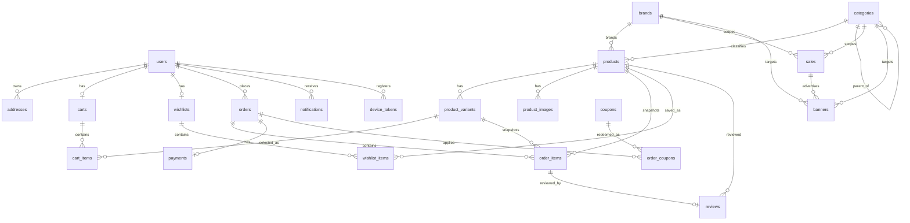

# EncueYPay — Developer Handoff & Single Source of Truth

**Snapshot:** 2026-11-07 · commit `6aaaa70`
**Platform:** Flutter (Dart) · mobile-first responsive
**Backend:** Supabase only — Auth, PostgREST, RPC, Storage, Realtime
**Architecture:** feature-driven clean architecture (`presentation → domain ← data`)

> **Precedence:** `docs/architecture-contract.md` → current code → this snapshot → `docs/DESIGN.md` and older specs. This document reverses-engineers the code as it exists. Anything not present in code is labeled.

**Evidence legend**

| Tag | Meaning |
|---|---|
| **As-built** | Extracted directly from current source, migrations, or live route definitions. |
| **Inferred** | Recommended interpretation or source-resolution guidance; not asserted by code. |
| **Not implemented** | Explicitly absent; do not assume it exists. |

---

## 0. Codebase Snapshot

| Item | Value |
|---|---|
| App entry | `lib/main.dart` → `EncueYPayApp` |
| State management | Riverpod 3 codegen (`@riverpod`), `Provider` for wiring only |
| Routing | GoRouter 18, named routes, `StatefulShellRoute.indexedStack` |
| Backend client | `supabase_flutter` 2.x |
| Local persistence | `shared_preferences` key `app.themeMode` only |
| Money model | `int` minor units + `Money` value object; USD primary, KHR display peg 4,100 |
| Feature domains | auth, catalog, cart, checkout, orders, dashboard, profile, wishlist, notifications, reviews, promotions, admin |
| Screens | 29 screen files |
| Named routes | 30 mounted route names (33 declarations; `profile`/`profileEdit`/`settings` reused by admin; `dashboard` constant unused) |
| Migrations | 46 files, final `20261107000002_admin_mark_cod_paid.sql` |
| Edge functions | `payway-create`, `payway-webhook`, `push-dispatch` |
| Analytics | **Not implemented** (no SDK, no event calls) |

**Commands**

```bash
flutter pub get
dart run build_runner build --delete-conflicting-outputs
flutter analyze
flutter test
flutter run --dart-define-from-file=config/.env
```

---

## 1. Product Overview & Actors

### 1.1 Product summary

EncueYPay is a single-seller Cambodian commerce app. Customers browse a branded catalog, choose explicit product variants, pay by **KHQR** or **cash on delivery**, and track a server-driven order lifecycle. Admins run the same application through a four-tab executive shell: dashboard, products, orders, and reports.

**Core value proposition**

- One trusted storefront: products, brands, categories, promotions, and banners are admin-curated.
- Server-authoritative pricing and stock: the client never computes the charge.
- Exact money: integer minor units, USD display with tabular figures, KHR approximation at 4,100 KHR/USD.
- KHQR-first digital payment with a realtime verification state; COD remains available.
- Honest fulfillment UI: the visible status is the server lifecycle; no fabricated courier, ETA, warranty, or returns.

### 1.2 Actors and roles

| Role | Status | Surface | Summary |
|---|---|---|---|
| Customer | Active | 5-tab shell: Home, Discover, Cart, Orders, Profile | Browse, wishlist, cart, checkout, pay, track, review, manage profile/addresses. |
| Admin | Active | 4-tab shell: Dashboard, Products, Orders, Reports | Manage catalog/promotions/orders/settings, view KPIs and audit logs. |
| Business | Dormant | Falls back to customer tabs | Enum value retained; portal removed. |
| Driver | Dormant | Falls back to customer tabs | Enum value retained; portal removed. |

`users.active_role` is the single role selector. The router selects the tab set from `tabsForRole(role)` and the default landing route from `defaultRouteForRole(role)`. Only `customer` and `admin` have distinct surfaces.

### 1.3 Permission matrix (as-built)

| Capability | Customer | Admin |
|---|---|---|
| Public catalog/category/brand/banner reads | Yes | Yes |
| Own profile, addresses, wishlist, cart, orders, payments, notifications | Yes | Own account only |
| Add/update/remove cart lines | Yes | No cart UI |
| Validate coupon / preview totals / place order | Yes | No customer checkout UI |
| Cancel own order | Pending/confirmed only; not a QR order whose payment is no longer pending | Via admin transition |
| Submit review | Delivered order item, once | No |
| Product/variant/image CRUD | No | Yes |
| Category/brand CRUD | No | Yes |
| Sale/coupon/banner create/toggle/moderate | No | Yes |
| Order status transition / cancel with reason | No | Yes |
| Mark COD paid | No | Delivered COD orders only |
| Reports, KPIs, audit log, platform settings | No | Yes |

Server guards use `is_admin()` inside admin RPCs and RLS policies for own-row access. The UI is not a security boundary.

### 1.4 Core workflows

**Customer purchase**

1. Sign in with email/password or Google OAuth.
2. Browse Home → Discover → Product Detail.
3. Select an explicit variant and quantity; add to cart (server RPC).
4. Review cart; open single-page checkout.
5. Choose delivery address, payment method, optional coupon and note.
6. Review server-previewed totals; place order atomically.
7. COD: confirmation screen. KHQR: PayWay QR is created; screen waits for webhook-confirmed verification.
8. Track order from Orders → Order Detail; review delivered items.

**Admin fulfillment**

1. Dashboard surfaces sales, stock alerts, 14-day trend, top sellers.
2. Products: search/filter, adjust stock, archive/restore, edit variants/images.
3. Orders: advance pending → confirmed → processing → packed → shipped → out for delivery → delivered, or cancel with a reason.
4. Delivered COD orders can be marked paid.
5. Reports: date-range KPIs, payment split, best sellers, categories, brands, purchase frequency.
6. Sales/coupons/banners are authored under Dashboard → Promotions.

**Promotion/pricing model**

- Sales are price layers: platform, brand, or category scope; percent or fixed; active window; no code, no minimum, no stacking.
- Coupons are standalone cart-wide codes applied at checkout; multiple valid codes stack, capped at subtotal.
- `best_sale_price_minor()` is the single SQL pricing rule used by display, cart view, preview, and placement.

### 1.5 Hard invariants

- Server is authoritative for prices, stock, order state, and payment state.
- Product stock is product-wide; every variant shares it.
- Variants are explicit and priced; there is no implicit null-price “Default”.
- Orders are immutable historical snapshots for line items and shipping.
- No local database/cache; only theme mode is persisted locally.
- No returns/refunds flow in the app; the DB no longer has return tables.
- KHQR verification only becomes “verified” after a server-side confirmation.

---

## 2. Visual Design System & Tokens (UI Core)

### 2.1 Color palette

Tokens live in `lib/core/presentation/theme/app_colors.dart`; the app uses an explicit `ColorScheme` per brightness (no seed derivation).

**Brand and semantic tokens**

| Token | Hex | Usage |
|---|---|---|
| `primaryNavy` | `#0F172A` | Shell headers, major titles, dark shadow ink |
| `primaryRoyal` | `#1E3A8A` | Primary CTAs, active states, key accents |
| `primaryRoyalHover` | `#1D4ED8` | Hover/pressed; dark-mode primary |
| `primarySubtle` | `#EFF6FF` | Selected containers, nav indicator |
| `accentEmerald` | `#059669` | Success, verified, paid |
| `accentEmeraldLight` | `#ECFDF5` | Success container |
| `accentAmber` | `#D97706` | Ratings, pending, warnings |
| `accentAmberLight` | `#FFFBEB` | Warning container |
| `accentRose` | `#E11D48` | Out of stock, cancelled, errors |
| `accentRoseLight` | `#FFF1F2` | Error container |
| `promotionCoral` | `#FF5722` | Promotions, coupons, flash sales |
| `khqrRed` | `#D32027` | Official NBC Bakong KHQR header / KHQR accent |
| `khqrBg` | `#FFFFFF` | KHQR card body |
| `kCodAccent` | `#0F766E` | COD accent (teal 700) |

**Light surfaces and text**

| Token | Hex | Usage |
|---|---|---|
| `backgroundLight` | `#F8FAFC` | Page background (`surface`) |
| `surfaceLight` | `#FFFFFF` | Cards, sheets, inputs |
| `surfaceContainerLight` | `#F1F5F9` | Secondary containers, chips |
| `borderLight` | `#E2E8F0` | Dividers, borders |
| `textPrimaryLight` | `#0F172A` | Headlines |
| `textSecondaryLight` | `#64748B` | Subtitles, labels |
| `textMutedLight` | `#94A3B8` | Placeholder/inactive |

**Dark surfaces and text**

| Token | Hex | Usage |
|---|---|---|
| `backgroundDark` | `#090D16` | Page background |
| `surfaceDark` | `#131B2E` | Cards |
| `surfaceContainerDark` | `#1E293B` | Secondary containers |
| `borderDark` | `#27354F` | Borders |
| `textPrimaryDark` | `#F8FAFC` | Headlines |
| `textSecondaryDark` | `#94A3B8` | Subtitles |
| `textMutedDark` | `#64748B` | Placeholder/inactive |

**Material 3 scheme mapping**

| Scheme slot | Light | Dark |
|---|---|---|
| `primary` | `primaryRoyal` `#1E3A8A` | `primaryRoyalHover` `#1D4ED8` |
| `onPrimary` | white | white |
| `primaryContainer` | `primarySubtle` `#EFF6FF` | `#16223E` |
| `onPrimaryContainer` | `primaryRoyal` | `#93C5FD` |
| `secondary` | `primaryNavy` | `textPrimaryDark` |
| `secondaryContainer` | `#F1F5F9` | `#1E293B` |
| `tertiary` | `accentEmerald` `#059669` | `#34D399` |
| `error` | `accentRose` `#E11D48` | `#FB7185` |
| `errorContainer` | `#FFF1F2` | `#331222` |
| `surface` | `#F8FAFC` | `#090D16` |
| `onSurface` | `#0F172A` | `#F8FAFC` |
| `surfaceContainerLowest` | `#FFFFFF` | `#131B2E` |
| `surfaceContainerHighest` | `#E2E8F0` | `#27354F` |
| `onSurfaceVariant` | `#64748B` | `#94A3B8` |
| `outlineVariant` | `#E2E8F0` | `#27354F` |

**Status badge palette** (keyed by wire status; unknown falls back to slate)

| Wire name | Background | Foreground |
|---|---|---|
| `pending` | `#FFFBEB` | `#B45309` |
| `confirmed` | `#EFF6FF` | `#1D4ED8` |
| `processing` | `#EEF2FF` | `#4338CA` |
| `packed` | `#F0F9FF` | `#0369A1` |
| `shipped` | `#ECFEFF` | `#0E7490` |
| `out_for_delivery` | `#F0FDFA` | `#0F766E` |
| `delivered` | `#ECFDF5` | `#047857` |
| `cancelled` | `#FFF1F2` | `#BE123C` |
| `refunded` | `#F1F5F9` | `#334155` |
| fallback | `#F1F5F9` | `#334155` |

Dark mode badges blend the foreground at 18% into the dark surface and lighten the foreground toward white.

### 2.2 Typography scale

Font: **Plus Jakarta Sans**, bundled as 400/500/600/700/800 static TTFs.

| Token | Size | Weight | Letter spacing | Line height | Usage |
|---|---:|---:|---:|---:|---|
| `displayLarge` | 32 | 800 | -0.8 | 1.2 | Hero numerals, spending hero |
| `headlineMedium` | 24 | 700 | -0.5 | 1.25 | Screen headlines |
| `headlineSmall` | 22 | 700 | -0.4 | 1.25 | AppBar titles, dialogs |
| `titleLarge` | 20 | 600 | -0.3 | 1.3 | Section titles |
| `titleMedium` | 16 | 600 | -0.2 | 1.35 | Card/list titles |
| `titleSmall` | 14 | 600 | -0.1 | 1.3 | Dense card titles, trailing values |
| `bodyLarge` | 16 | 400 | 0 | 1.5 | Lead paragraphs |
| `bodyMedium` | 14 | 400 | 0 | 1.45 | Default copy |
| `bodySmall` | 12 | 400 | 0 | 1.4 | Supporting copy |
| `labelLarge` | 14 | 600 | 0.1 | 1.2 | Buttons, prominent labels |
| `labelMedium` | 12 | 600 | 0.15 | 1.2 | Secondary badges, tab labels |
| `labelSmall` | 11 | 600 | 0.2 | 1.2 | Badges, chips, captions |
| `priceHighlight` | 18 | 700 | -0.4 | default | Prices, tabular figures |

`TextTheme` colors: primary = `#0F172A` light / `#F8FAFC` dark; secondary = `#64748B` light / `#94A3B8` dark.

### 2.3 Spacing, radii, elevation, targets

| Token | Value | Usage |
|---|---:|---|
| `xs` | 4dp | Badge margins, icon-label gap |
| `sm` | 8dp | Tight item/chip/form spacing |
| `md` | 16dp | Screen margins, card padding |
| `lg` | 24dp | Section gaps, modal header |
| `xl` | 32dp | Hero gaps, dialog padding |
| `xxl` | 48dp | Empty-state margins, top/bottom clearance |
| `r8` | 8dp | Buttons, chips, status badges |
| `r12` | 12dp | Text fields, small cards, notification tiles |
| `r16` | 16dp | Product cards, order items, sheets |
| `r24` | 24dp | Bottom sheets, dialogs, hero containers |
| `full` | 999dp | Avatars, pill tags, steppers |
| `AppTargets.minimum` | 48dp | Minimum interactive edge |

**Elevations**

| Level | Shadow | Usage |
|---|---|---|
| 0 | 1dp `outlineVariant` border, no shadow | Default cards, AppBar |
| 1 | `0x080F172A`, blur 8, offset (0,2) | EncueCard light mode |
| 2 | `0x120F172A`, blur 16, offset (0,-4) | Floating checkout dock |
| 3 | `0x240F172A`, blur 24, offset (0,8) | KHQR card / sheet |

### 2.4 Responsive rules

| Breakpoint | Width | Product grid | Notes |
|---|---:|---:|---|
| `compact` | `< 600dp` | 2 columns | Bottom `NavigationBar`, edge-to-edge content |
| `medium` | `600–839dp` | 3 columns | Same bottom bar; forms capped by `ContentWidth` |
| `expanded` | `>= 840dp` | 4 columns | Same bottom bar; max readable width 720dp |

- All width branching goes through `context.screenSize`.
- `ContentWidth(maxWidth: 720)` wraps forms, checkout, order detail, reports.
- No scaling package; text scaling remains platform-driven.

### 2.5 UI component library and states

| Component | Anatomy | Visual states | Behavior/notes |
|---|---|---|---|
| `EncueButton` | Label + optional 18dp icon; r8, 48dp min height | `primary`, `secondary`, `outline`, `destructive`; default, pressed, focused, disabled | `expand: true` by default (full width). Loading is caller-supplied spinner. |
| `FilledButton` theme | Primary fill, white label, r8 | default/pressed/focused/disabled | Global theme; 64×48 min size, 24dp horizontal padding. |
| `EncueCard` | r16, 1dp border, optional elevation 1 | flat/elevated, tappable, long-pressable | Light mode gets elevation-1 shadow; dark stays flat. |
| `ProductCard` | Flex image, NEW + brand pills, wishlist heart, availability pill, title/rating/sale price | default, sale, new, wishlisted, archived (“Unavailable”), out of stock, skeleton | Tap → detail; long-press → quick actions; disabled products remain tappable for explanation. |
| `StatusBadge` | r8 label chip, optional 12dp icon | wire-name palette; dense variant | Unknown status → neutral slate. |
| `KhqrCard` | Red “KHQR / BAKONG” header, merchant, USD + KHR, 220dp QR, caption | pending payload, ready | White card, r16, sheet shadow; payload is resolved server-side. |
| `MonogramImage` | Network image → skeleton → monogram fallback | loading, loaded, error/empty | Deterministic accent pair from name; initials or supplied icon. |
| `PriceText` | USD primary + `≈ KHR` caption | with/without KHR | Tabular figures; integer math. |
| `AsyncValueWidget` | Cross-faded loading/error/data | skeleton, error + retry, data | Keeps prior data during refetch. |
| `EmptyStateView` | 72dp circle icon + title + description + optional action | empty | Shared empty vocabulary. |
| `SkeletonBox` / `SkeletonListView` | Pulsing blocks; 1200ms reverse | loading | Shape matches final content. |
| `OrderStatusTimeline` | Vertical connected stepper, 7 stages | done, current (pulse), upcoming, cancelled notice | Reduced motion freezes pulse. |
| `OrderTrackingCard` | Simplified 4-stage progress + exact-status toggle | in flight, delivered, cancelled | No courier/ETA fabrication. |
| `NavigationBar` | 72dp, 24dp icons, labelMedium | selected/unselected; Cart badge pop | Branch order == destination order. |
| `AppBar` | Flat, surface background, no tint | default, back/action | `centerTitle: false`, titleLarge. |
| Inputs | Filled, r12, 14dp vertical padding | enabled, focused (1.6dp primary), error (1.6dp), disabled | Global `InputDecorationTheme`. |
| Dialogs | r24, surface, barrier `#660F172A` | default, destructive confirm | Title titleLarge, content bodyMedium. |
| Bottom sheets | r24 top, drag handle, white surface | default, scroll-controlled | `showDragHandle: true`. |
| Snackbar | Floating r12, navy/dark surface | info, error, action | 6s duration for foreground push fallback. |

**Interaction rules**

- 48dp touch targets are the floor.
- Icon-only actions carry tooltips.
- Mutations never optimistically mutate state; the server refetch is the source of truth.
- Errors remain inline or in snackbars; a form is never replaced by a raw error screen.
- Loading keeps the final layout shape (skeleton), not a centered spinner, on content screens.
- One primary CTA per viewport where possible.

---

## 3. Asset & Icon Specifications

### 3.1 Bundled assets

| Asset | Path | Notes |
|---|---|---|
| Font family | `assets/fonts/PlusJakartaSans-*.ttf` | Bundled static instances; Latin subset. |
| Cambodia geo hierarchy | `assets/geo/provinces.json`, `assets/geo/provinces/01.json` … `25.json` | Official 2025 administrative codes; ~1.4MB. Loaded offline for address forms. |
| Launcher icons | `android/app/src/main/res/mipmap-*/ic_launcher.png`, `ios/Runner/Assets.xcassets/AppIcon.appiconset/*` | Platform-generated; not referenced in Dart. |
| Launch images | `android/.../launch_background.xml`, `ios/.../LaunchImage.imageset/*` | Platform splash assets. |

**No bundled product/banner/category/brand imagery exists.** All catalog imagery is network-loaded.

### 3.2 Remote imagery and storage buckets

| Bucket | Visibility | Path convention | Used by |
|---|---|---|---|
| `product_images` | Public | `{product_id}/{timestamp}_{filename}` for product images; `variants/{timestamp}_{filename}` for variant images | Products, variants, carts, orders, wishlist, admin |
| `catalog_assets` | Public | `catalog/{timestamp}_{filename}` | Category/brand images |
| `promo_assets` | Public | `{user_id}/{timestamp}_{filename}` | Banner/sale imagery |
| `avatars` | Public | `{user_id}/{timestamp}_{filename}` | Profile avatar |
| `payment_proofs` | Private | `{user_id}/{order_id}/{timestamp}_{filename}` | Legacy bank-transfer proof upload |

- DB stores the storage path or a full `http(s)` URL. Full URLs pass through untouched.
- Public URLs are resolved at the repository boundary, never in UI.
- `payment_proofs` is customer-own + admin-read.

### 3.3 Rendered dimensions and aspect ratios

| Surface | Rendered shape | Source guidance (**Inferred**) |
|---|---|---|
| Home banner | Full-width, 148dp high, 16dp side padding | 1600×600 or wider, ~2.5:1 |
| Category card | 4:3 aspect | 800×600 |
| Brand rail | 108dp wide, 1:1 image | 512×512 |
| Product card | Grid ratio 0.62; image flex-fills remaining height | Square 1200×1200; 2×/3× variants |
| Product detail carousel | 260dp high, full width | 1600×1200 or square; cover fit |
| Variant thumbnail | 64×64 | 256×256 |
| Related product rail | 140dp wide, 220dp rail | Same as product card |
| Cart/order line thumb | 64×64 | 256×256 |
| Checkout line thumb | 44×44 | 176×176 |
| Profile avatar | 64dp diameter (radius 32) | 512×512 |
| KHQR code | 220×220 | Vector-rendered from payload |
| Admin product tile | 48×48 | 192×192 |
| Admin product form image | 88×88 | 352×352 |
| Admin variant image | 52×52 | 208×208 |
| Reports ranked thumb | 40×40 | 160×160 |

### 3.4 Iconography

- Set: **Material Icons** (`uses-material-design: true`).
- `cupertino_icons` is declared but **not used** in `lib/`.
- No custom SVG icon set and no `flutter_svg` dependency.
- Stroke/fill conventions follow Material symbols; no custom icon font.

**Key icon map**

| Domain | Icons |
|---|---|
| Navigation | `storefront`, `travel_explore`, `shopping_cart`, `receipt_long`, `person`, `admin_panel_settings`, `inventory_2`, `query_stats` |
| Catalog | `search`, `sort`, `sell_outlined`, `category_outlined`, `local_offer_outlined`, `favorite`, `favorite_border`, `star`, `star_half`, `star_border`, `qr_code_2` |
| Commerce | `add_shopping_cart_outlined`, `remove_shopping_cart_outlined`, `add`, `remove`, `delete_outline`, `delete_sweep_outlined`, `shopping_cart_outlined` |
| Checkout/payment | `local_shipping_outlined`, `payment_outlined`, `payments_outlined`, `download_outlined`, `share_outlined`, `hourglass_top_rounded`, `verified_outlined`, `check_circle_outline` |
| Profile/location | `person_outline`, `phone_outlined`, `email_outlined`, `location_on_outlined`, `my_location_outlined`, `add_location_alt_outlined`, `map`-equivalent via `CurrentLocationMap` |
| Admin | `insights_outlined`, `campaign_outlined`, `history`, `settings_outlined`, `warning_amber_outlined`, `trending_up`, `trending_down`, `archive_outlined`, `unarchive_outlined`, `refresh` |
| Feedback | `cloud_off_outlined`, `error_outline`, `info_outline`, `check_circle`, `cancel_outlined`, `notifications_none` |

Ratings use 18dp stars on cards (12dp compact), 36dp stars in review compose. Icon sizes range from 10–14dp in badges to 72dp in success states.

---

## 4. Screen Specifications & Scenarios (Route by Route)

### 4.1 Route map

| Route name | Path | Screen file | Shell |
|---|---|---|---|
| `login` | `/login` | `login_screen.dart` | Outside shell |
| `helpSupport` | `/help` | `help_support_screen.dart` | Top-level overlay |
| `helpFeedback` | `/help/feedback` | `help_feedback_screen.dart` | Top-level overlay |
| `about` | `/about` | `about_screen.dart` | Top-level overlay |
| `home` | `/home` | `home_screen.dart` | Customer tab 1 |
| `productDetail` | `/home/product/:id` | `product_detail_screen.dart` | Nested under Home |
| `notifications` | `/home/notifications` | `notifications_screen.dart` | Nested under Home |
| `discovery` | `/discovery?kind=&id=&name=&image=&q=` | `discovery_screen.dart` | Customer tab 2 |
| `cart` | `/cart` | `cart_screen.dart` | Customer tab 3 |
| `cartAddresses` | `/cart/addresses` | `addresses_screen.dart` | Nested under Cart |
| `cartAddressEdit` | `/cart/addresses/edit` | `address_edit_screen.dart` | Nested under Cart |
| `checkout` | `/cart/checkout` | `checkout_screen.dart` | Nested under Cart |
| `checkoutAddressEdit` | `/cart/checkout/address/edit` | `address_edit_screen.dart` | Nested under Cart |
| `orderPlaced` | `/cart/checkout/placed/:id` | `order_placed_screen.dart` | Nested under Cart |
| `orders` | `/orders` | `orders_screen.dart` | Customer tab 4 |
| `reviewCompose` | `/orders/review` | `review_compose_screen.dart` | Nested under Orders |
| `orderDetail` | `/orders/:id` | `order_detail_screen.dart` | Nested under Orders |
| `profile` | `/profile` | `profile_screen.dart` | Customer tab 5 |
| `profileEdit` | `/profile/edit` | `profile_edit_screen.dart` | Nested under Profile |
| `addresses` | `/profile/addresses` | `addresses_screen.dart` | Nested under Profile |
| `addressEdit` | `/profile/addresses/edit` | `address_edit_screen.dart` | Nested under Profile |
| `wishlist` | `/profile/wishlist` | `wishlist_screen.dart` | Nested under Profile |
| `settings` | `/profile/settings` | `settings_screen.dart` | Nested under Profile |
| `adminDashboard` | `/admin/dashboard` | `admin_dashboard_screen.dart` | Admin tab 1 |
| `adminAudit` | `/admin/dashboard/audit` | `audit_logs_screen.dart` | Nested under Dashboard |
| `adminSettings` | `/admin/dashboard/settings` | `platform_settings_screen.dart` | Nested under Dashboard |
| `adminCategories` | `/admin/dashboard/categories` | `categories_admin_screen.dart` | Nested under Dashboard |
| `adminBrands` | `/admin/dashboard/brands` | `brands_admin_screen.dart` | Nested under Dashboard (quick action) |
| `adminPromotions` | `/admin/dashboard/promotions` | `admin_promotions_screen.dart` | Nested under Dashboard |
| `adminArchivedCoupons` | `/admin/dashboard/promotions/archive` | `archived_coupons_screen.dart` | Nested under Promotions |
| `profile` (admin) | `/admin/dashboard/account` | `profile_screen.dart` | Nested under Dashboard |
| `profileEdit` (admin) | `/admin/dashboard/account/edit` | `profile_edit_screen.dart` | Nested under Account |
| `settings` (admin account) | `/admin/dashboard/account/settings` | `settings_screen.dart` | Nested under Account |
| `adminProducts` | `/admin/products` | `admin_products_screen.dart` | Admin tab 2 |
| `adminProductForm` | `/admin/products/form` | `admin_product_form_screen.dart` | Nested under Products |
| `adminOrders` | `/admin/orders` | `admin_orders_screen.dart` | Admin tab 3 |
| `adminOrderDetail` | `/admin/orders/:id` | `admin_order_detail_screen.dart` | Nested under Orders |
| `adminReports` | `/admin/reports` | `admin_reports_screen.dart` | Admin tab 4 |
| — | unmatched path | `not_found_screen.dart` | Error builder |

`AppRoutes.dashboard` (`'dashboard'`) exists but is not mounted; do not use it.

**Route guards**

- While auth resolves, `/` is held on `/login`.
- Unauthenticated users are redirected to `/login`.
- Authenticated users on `/login` or `/` go to `defaultRouteForRole`.
- Customer default: `home`; admin default: `adminDashboard`.
- Leaving `orderPlaced` invalidates `cartControllerProvider`.

**Transition behavior (as-built)**

- No custom `pageBuilder` or route transition is defined.
- All pushes use GoRouter/Material defaults (platform page transition; iOS Cupertino back swipe where applicable).
- Branch switches are `StatefulShellRoute.indexedStack` — tab state is retained and switches without a route transition.
- Bottom-sheet/dialog entrances use Flutter’s Material defaults.

---

### 4.2 Customer screens

#### 4.2.1 Login — `login`
**Goal:** Authenticate or create an account; recover password; Google OAuth.
**Layout:** SafeArea → centered scroll → max 400dp form: wallet icon 56dp → “EncueYPay” headline → subtitle → conditional full-name → email → password with visibility toggle → forgot password → inline form error → primary submit → mode toggle → “or” divider → Google button.
**Happy path:** Sign in → session stream updates → router redirects to role home. Sign up → Supabase sign-up with `full_name` metadata. Google → external browser → deep link `io.supabase.encueypay://login-callback/`.
**Alternates/edges:** email must contain `@`; password ≥ 6; full name required on sign-up; reset dialog validates `@`; loading disables all controls and shows a 20dp spinner; auth failure appears inline; Google launch failure/timeout shows a network message.
**Pre-conditions:** No active session. **Post-conditions:** Session stream emits user; route redirects. Sign-up may await email confirmation server-side.

#### 4.2.2 Home — `home`
**Goal:** Storefront entry: search, featured campaigns, categories, brands, new arrivals.
**Layout:** AppBar “EncueYPay” + notifications + avatar → ListView: search pill → “Featured” autoplay banner carousel (148dp, dots) → “Shop by category” 4:3 cards → “Top brands” horizontal 108dp rail → “New arrivals” grid (2/3/4 columns).
**Happy path:** Tap search/discover → Discovery; tap category/brand/banner → Discovery pre-filtered; tap product → Product Detail; avatar → Profile.
**Alternates/edges:** Empty banners/categories/brands collapse; section errors show inline cloud icon + retry; product grid skeleton matches final shape; no products → “No products yet.”; image failure → monogram; banners autoplay every 5s only when ≥2.
**Pre-conditions:** Authenticated. **Post-conditions:** Navigation/filter context; Home refetches feed when reactivated.

#### 4.2.3 Discovery — `discovery`
**Goal:** Unified search, filter, sort, and paginated browse.
**Layout:** AppBar “Discover” → search field → optional dimension banner (brand/category, removable) → category chips (parents + indented children) → brand chips → result count + sort menu → product grid with infinite scroll → empty state.
**Happy path:** Submit keyword → server search over product and brand names; select category/brand chip; choose Newest / Price ↑ / Price ↓ / Name ↑ / Name ↓; scroll to load 20 more; tap product.
**Alternates/edges:** `No products match` + “Clear filters” when any filter/deep link is active; pagination spinner; error branch with retry; deep link clears to unfiltered via ×; query sanitized for `,` and `()`; parent category includes child products.
**Pre-conditions:** Optional `kind`/`id`/`name`/`image`/`q` params seed filters. **Post-conditions:** In-tab filter state persists across pagination/tab switches.

#### 4.2.4 Product Detail — `productDetail`
**Goal:** Sell one product through variant selection and a clear, honest purchase surface.
**Layout:** AppBar “Product Details” → scroll: 260dp image pager + dots + “KHQR Ready” badge → variant thumbnail rail (when >1) → brand tag → product name → rating/review count → stock line → dual-currency price (strike-through when sale) → sale chip → store promises card → description → reviews → related products rail → bottom fixed bar: wishlist icon + “Add to Cart” with price.
**Happy path:** Select variant (carousel re-leads variant image) → open variant sheet → choose quantity (1–99, capped by stock) → add to cart (server) → snackbar “Added to cart” → cart badge updates.
**Alternates/edges:** Loading spinner / error + retry; archived → “This product is currently unavailable.” with disabled CTA; stock 0 → “Out of stock” + disabled CTA; no reviews → “No review available.”; no description omitted; sale chip opens detail sheet; image failure placeholder; wishlist failure snackbar with “Sign in” when session absent; variant sheet cannot open without selection.
**Pre-conditions:** Product id exists. **Post-conditions:** Cart and/or wishlist refetched from server.

#### 4.2.5 Notifications — `notifications`
**Goal:** Persistent notification inbox over a realtime stream.
**Layout:** AppBar + “Mark all read” when unread → grouped list Today / Yesterday / Earlier → notification cards with type icon, title, content, time, unread dot, order link row.
**Happy path:** Tap unread → mark read; if `order_id` present → Order Detail; “Mark all read” clears the badge.
**Alternates/edges:** Stream error renders error + retry, never the empty state; empty state explains order/payment alerts; legacy rows without order id only mark read; realtime reconnects.
**Pre-conditions:** Authenticated. **Post-conditions:** Read state persisted server-side.

#### 4.2.6 Cart — `cart`
**Goal:** Review, filter, select and edit the server cart before checkout.
**Layout:** AppBar “Cart (n)” + clear-cart action → white header band (delivery-address preview → “R67 Official Store” → search, All / On sale / Sold out chips, sort sheet) on a grouped gray page → line cards with tick circle, thumbnail, variant chip, low-stock/unavailable warning, price, stock-capped pill stepper; swipe-to-delete → “Why shop with R67” trust card (shared `StorePromisesCard`) → floating dock: select-all, selected total USD + KHR, Checkout. Empty state: “Your cart is empty”.
**Happy path:** Tick lines (or All) → +/- quantity (stock-capped) → delete line (swipe or detail) → tap line → Product Detail → Checkout with only the ticked cart-item ids → `/cart/checkout`. Unticked lines stay in the cart after the order.
**Alternates/edges:** 0-stock line cannot be ticked or ordered; sale line shows discounted price with original struck through; filters/search/sort are client-side and combine; no matches → clear-filters empty state; removal animates only after server-confirmed refetch; header address opens the cart-scoped address list; load error + retry; mutation failure snackbar; loading spinner; dock clears 156dp list bottom padding.
**Pre-conditions:** Authenticated. **Post-conditions:** Cart persisted server-side; checkout consumes the selection.

#### 4.2.7 Checkout — `checkout`
**Goal:** Single-page review and atomic order placement.
**Layout:** AppBar “Checkout” → max 720dp scroll: Order items → Delivery address radio list + add address → Delivery & payment (standard fee, COD/KHQR radio) → Coupon input + applied/rejected tiles → Order note → Summary (subtotal, discounts, delivery, total, KHR, QR hint) → fixed bottom bar: total + “Place order”.
**Happy path:** Default address preselected → choose method → apply valid coupon(s) → note optional → totals preview refreshes → Place order → `/cart/checkout/placed/:id`.
**Alternates/edges:** No address → CTA disabled + “Select a delivery address”; empty cart → CTA disabled; placement error stays on page and snackbars, preserving notes/coupons/address; coupon rejection messages (unknown, inactive, not started, expired, minimum spend, empty cart, unauthenticated); preview error notice + retry; `isPlacing` absorbs input and shows spinner; QR hint states payment happens after placement.
**Pre-conditions:** Authenticated; at least one ticked cart line. **Post-conditions:** Atomic order + pending payment for the selected lines, stock deducted, those lines removed from the cart (unselected lines remain).

#### 4.2.8 Checkout Address Edit — `checkoutAddressEdit`
**Goal:** Create an address inline without leaving checkout.
**Layout:** Same address form as Profile → app bar “Add address” → contact/location/street/save.
**Happy path:** Save → pop → checkout refreshes addresses and preserves note/coupons/payment.
**Alternates/edges:** Identical validation/geo/permission states to Address Edit; refresh failure snackbar; new address may become selected.
**Pre-conditions:** Checkout open. **Post-conditions:** Address row created; checkout list refreshed.

#### 4.2.9 Order Placed — `orderPlaced`
**Goal:** Confirm order creation and complete/observe payment without falsely claiming success.
**Layout:** AppBar title “Complete payment” when pending QR, else “Order summary” → status body → compact order summary card → “View order details” → “Back to Home”.
**Happy path:** COD → thank-you, pay on delivery. QR → create PayWay transaction once → KHQR card → save/share image → realtime/polling waits → `transaction_verified` → verified celebration with amount.
**Alternates/edges:** QR creation failure card + retry; payload missing → spinner; payment fetch error + retry; save/share failure snackbar; verified is the only paid state; cross-fade + animated height; leaving invalidates cart.
**Pre-conditions:** Order id exists; payment row exists. **Post-conditions:** Verification state persists server-side; navigation to detail/home.

#### 4.2.10 Orders — `orders`
**Goal:** Paginated order history with status/date filters and live refresh.
**Layout:** AppBar “Orders” → filter chips All / Active / Completed / Cancelled + date-range chip + clear → order cards: id, status badge, date/item count, USD + KHR total, Track Order, Leave Review when delivered → pagination spinner.
**Happy path:** Filter/date range → server refetch; tap card or Track → detail; review → detail; infinite scroll loads 10.
**Alternates/edges:** Empty state; realtime refresh preserves filters and loaded window; transient refresh failures keep current list; error + retry; lazy expired-QR cleanup on load.
**Pre-conditions:** Authenticated. **Post-conditions:** Navigation; filters retained in controller.

#### 4.2.11 Order Detail — `orderDetail`
**Goal:** One order’s tracking, items, payment, shipping, totals, review entry, cancellation.
**Layout:** AppBar “Order details” → header id/status/date → tracking card (headline, simplified 4 stages, exact timeline toggle) → cancellation reason → Items → Payment + proof upload when legacy bank transfer pending → Shipping details → totals → delivered review list (Reviewed/Review) → Cancel order when allowed.
**Happy path:** Watch order; admin transition updates via realtime; tap item → product; review delivered item → Review Compose; cancel pending/confirmed with confirm dialog → pop.
**Alternates/edges:** QR paid order not cancellable; cancel/upload failure snackbar without wiping order; proof upload hidden after submission; loading/error + retry; no courier details/ETA are shown.
**Pre-conditions:** Order belongs to customer. **Post-conditions:** Cancel/upload persisted and detail/list invalidated.

#### 4.2.12 Review Compose — `reviewCompose`
**Goal:** Submit the single review allowed per purchased order item.
**Layout:** AppBar “Write a review” → product name → 5 star buttons (36dp) → 4-line text field → Submit → “Reviews are read-only once submitted.”
**Happy path:** Choose 1–5 stars, optional text → submit → invalidate order detail/list + product page → replace with Product Detail showing review.
**Alternates/edges:** Submitting spinner; error snackbar; empty product id → pop (still invalidates); server enforces ownership, delivered purchase, rating 1–5, one per item.
**Pre-conditions:** Router `extra` record `(orderId, orderItemId, productId, productName)`. **Post-conditions:** Review persisted; order detail shows “Reviewed” without a manual refresh; product page fetches the new review.

#### 4.2.13 Profile — `profile`
**Goal:** Account hub with customer overview.
**Layout:** AppBar “Profile” → identity card (64dp avatar + camera badge, name, phone, upload hint) → customer overview panel (royal spending hero, counts, recent orders, wishlist rail, cart summary) → Edit profile → Addresses → Wishlist → Help & support → Help and feedback → About R67 → Settings → Sign out.
**Happy path:** Tap avatar → image picker → upload → snackbar; open nested screens; pull to refresh the overview; sign out confirm → unregister device token → session clear → login.
**Alternates/edges:** Cold loading spinner; error + retry; mutations keep profile visible; avatar upload spinner; empty overview rows; admin variant hides customer overview/addresses/wishlist. “Total spending” sums every non-cancelled order (DESIGN §5.1.5), so a just-placed pending order counts immediately; the dashboard refetches on order-placed exit, on every Profile tab visit and on pull-to-refresh, so a missed realtime event cannot leave it stale.
**Pre-conditions:** Authenticated. **Post-conditions:** Profile/avatar persisted; sign-out returns to login.

#### 4.2.14 Edit Profile — `profileEdit`
**Goal:** Edit display name and phone.
**Layout:** AppBar → full name (required) → phone (optional) → Save.
**Happy path:** Save → pop on success.
**Alternates/edges:** Prefills once after profile loads; late fetch never overwrites typing; save spinner; error snackbar; loading/error branch.
**Pre-conditions:** Profile available. **Post-conditions:** `users.full_name`/`phone` updated.

#### 4.2.15 Addresses — `addresses`
**Goal:** Manage delivery addresses and the single default.
**Layout:** AppBar “Addresses” → list of cards (default star, label · recipient, address line, set-default, delete) → FAB “Add”. Empty state with “Add address”.
**Happy path:** Add/edit via form; set default; delete with confirm.
**Alternates/edges:** Loading/error + retry; empty state; mutation errors snackbar; default one-per-user enforced by partial unique index + RPC.
**Pre-conditions:** Authenticated. **Post-conditions:** Address set persisted; checkout preselects default.

#### 4.2.16 Address Edit — `addressEdit`
**Goal:** Create/edit an address with Cambodian administrative hierarchy and optional map pin.
**Layout:** AppBar Add/Edit → Contact (label, recipient, phone) → Location (“Use my current location” + always-available “Pick on map”, verification map when a pin exists, province/district/commune/village dropdowns under “Or choose your address”, geo progress/error) → street/house, additional details → Save.
**Happy path:** New address prefills recipient/phone from profile → optional location prefill → select full hierarchy → enter street → Save → pop.
**Alternates/edges:** Label, recipient, line1 required; new address requires all four admin codes; partial hierarchy blocked; geo load error + retry; location permission/service error with “Open settings” (native); on web a blocked/insecure origin explains the https-or-localhost rule, a 30s locate timeout prevents a stuck spinner, the reason stays as a persistent inline card with **Try again** (not a transient snackbar), the map opens at Phnom Penh for tap-to-place, and map taps reverse-geocode into empty fields; detected hierarchy fills only empty fields; save failure stays on form.
**Pre-conditions:** Optional `Address` via `extra`; profile may be available. **Post-conditions:** Draft saved; list/checkout refreshed.

#### 4.2.17 Wishlist — `wishlist`
**Goal:** Saved products as shoppable cards.
**Layout:** AppBar “Wishlist” → ProductCard grid 2/3/4 columns; empty state “Your wishlist is empty” + “Browse products”.
**Happy path:** Tap card → detail; long-press → quick actions (wishlist/cart); remove via actions; browse → Home.
**Alternates/edges:** Loading/error + retry; empty; mutation failures snackbar; synthetic product mapping carries brand/rating/stock/default variant.
**Pre-conditions:** Authenticated. **Post-conditions:** Wishlist persisted server-side.

#### 4.2.18 Settings — `settings`
**Goal:** Theme mode only.
**Layout:** AppBar “Settings” → “Theme” label → SegmentedButton System / Light / Dark.
**Happy path:** Selection updates app immediately and persists.
**Alternates/edges:** No other settings; no local DB.
**Pre-conditions:** None. **Post-conditions:** `app.themeMode` written.

---

### 4.3 Admin screens

#### 4.3.1 Admin Dashboard — `adminDashboard`
**Goal:** Executive snapshot with actionable stock alerts.
**Layout:** AppBar “Admin dashboard” + avatar → KPI hero (realized sales — paid or delivered only, orders placed/customers, 7-day momentum) → stock alert card (low ≤5 / out) → 14-day bar chart → top 3 sellers → quick links: Reports, Categories, Brands, Promotions, Account, Audit logs, Platform settings.
**Happy path:** Tap alerts → Products; top seller → Product Detail; quick links open nested screens/tabs.
**Alternates/edges:** Loading spinner; error + retry; no trend/best sellers collapses; zero-sales days show stub bars; audit count uses loaded audit state.
**Pre-conditions:** Admin role. **Post-conditions:** Navigation.

#### 4.3.2 Admin Products — `adminProducts`
**Goal:** Inventory manager with product-wide stock.
**Layout:** AppBar “Products” + search field → filter chips All / Low Stock (≤5) / Out of Stock → list: 48dp image, name, “Unavailable” badge, category · brand · price · variants, [- stock +] pill, overflow Edit/Archive/Restore → FAB “Add”. Brand management lives under Dashboard → Brands.
**Happy path:** Adjust stock inline; edit/archive/restore; add product. Brand management opens from Dashboard → Manage brands.
**Alternates/edges:** Loading skeleton; empty filter state; busy opacity + disabled controls; errors snackbar; archived shows restore; low/out stock tinted.
**Pre-conditions:** Admin. **Post-conditions:** Server stock/status updated and list invalidated.

#### 4.3.3 Admin Product Form — `adminProductForm`
**Goal:** Create/edit a product with explicit variants and images.
**Layout:** AppBar Create/Edit → name, description → explanatory variant note → product-wide stock → Variants header + Add variant → variant rows (52dp image, name, price, archive/restore/remove) → category searchable picker (required) → brand optional picker → Images (max 8, 88dp tiles) → Create/Save.
**Happy path:** Add at least one named/priced variant → choose category → optional brand/images → Save → pop.
**Alternates/edges:** name/category/stock validation; at least one active variant; price max 2 decimals and non-negative server-side; last variant cannot be archived; removed existing variants archive (not delete); image limit snackbar; upload failure stays on form; edit preloads existing images/variants; busy Save spinner.
**Pre-conditions:** Admin; optional `AdminProductSummary` via `extra`. **Post-conditions:** Product/variants/images synced; base price derived from cheapest active variant.

#### 4.3.4 Brands — `adminBrands`
**Goal:** Manage catalog brands.
**Layout:** AppBar “Brands” → list with logo, name, description/status, edit/archive/restore/delete → FAB/add dialog.
**Happy path:** Create/edit name/description/logo; archive/restore; delete (products keep existing, brand becomes null).
**Alternates/edges:** Empty/loading/error; name required; image optional; delete confirm; errors snackbar.
**Pre-conditions:** Admin. **Post-conditions:** Brand persisted; catalog lists invalidated.

#### 4.3.5 Admin Orders — `adminOrders`
**Goal:** Oversight and entry into fulfillment.
**Layout:** AppBar “Orders” → list cards: customer · total, timestamp · item count · payment status, lifecycle chip → tap detail.
**Happy path:** Open order; list refreshes via orders/payments realtime.
**Alternates/edges:** Empty “No orders yet”; loading/error + retry; stream errors mapped; latest 50 fetched.
**Pre-conditions:** Admin. **Post-conditions:** Navigation.

#### 4.3.6 Admin Order Detail — `adminOrderDetail`
**Goal:** Advance or cancel one order; record COD payment.
**Layout:** AppBar “Order” → summary card (customer, date, subtotal/discount/fee/total/payment) → next transition button → Cancel order when pending/confirmed → Mark cash payment received when delivered COD unpaid → items.
**Happy path:** Move to next status; cancel with required reason (stock restored); mark COD paid after delivery.
**Alternates/edges:** Illegal transitions blocked server-side; reason required; COD button only delivered/COD/unpaid; missing order fallback; loading/error; refresh in place.
**Pre-conditions:** Admin; order id. **Post-conditions:** Status/payment updated; audit + notification side effects.

#### 4.3.7 Admin Reports — `adminReports`
**Goal:** Date-range executive reporting.
**Layout:** AppBar “Reports” → preset chips 7D/15D/30D/MTD/Custom → date label → responsive KPI grid (orders, completed, cancelled, realized orders, gross realized, AOV, net settled, inventory valuation) → realized-definition caption → payment split bar → ranked sections (best sellers, top categories, brand revenue, purchase frequency) → stock summary.
**Definition:** money metrics read the `realized_orders` view — delivered (COD collected) or `payments.status = 'transaction_verified'`, never cancelled/returned/refunded; AOV divides by that count. Order-funnel counts stay all orders.
**Happy path:** Choose preset/custom range → report refetches.
**Alternates/edges:** Loading skeleton/cross-fade; error + retry; empty ranked sections collapse; zero payment split hidden; KPI cards fit narrow widths.
**Pre-conditions:** Admin. **Post-conditions:** None (read-only).

#### 4.3.8 Promotions — `adminPromotions`
**Goal:** Author and moderate sales, coupons, and banners.
**Layout:** AppBar “Sales & coupons” + Refresh / New sale / New coupon / New banner → Sales list with active switch → Coupons header + Archived link → live/scheduled coupon tiles with switch/delete → Banners list with image/status/actions.
**Happy path:** Create sale (name, scope, brand/category, percent/fixed, window, optional banner) → live; create coupon (name, code, discount, minimum, window) → live; create display-only banner; toggle sale/coupon; delete unused coupon; moderate banner approve/reject/disable.
**Alternates/edges:** Required name/code/positive discount/scope group; percent ≤100; branded campaign requires brand; date windows; delete used coupon rejected (deactivate instead); confirmation dialogs for delete/reject/disable; empty states; pull-to-refresh.
**Pre-conditions:** Admin. **Post-conditions:** Promotion state persisted; storefront prices/banners update.

#### 4.3.9 Archived Coupons — `adminArchivedCoupons`
**Goal:** Read-only home for expired/deactivated codes.
**Layout:** AppBar “Archived coupons” → explanatory copy → coupon tiles with archive state.
**Happy path:** View only.
**Alternates/edges:** Empty “No archived coupons.”; loading/error + retry.
**Pre-conditions:** Admin. **Post-conditions:** None.

#### 4.3.10 Categories — `adminCategories`
**Goal:** Manage the 2-level catalog taxonomy.
**Layout:** AppBar “Categories” → list with image, name, parent/child indentation, edit/delete → create action.
**Happy path:** Create with optional parent/image; edit name/image/parent; delete.
**Alternates/edges:** Name required; parent must be top-level; no self-parent; delete cascades/blocks per FK behavior; loading/error; image upload errors snackbar.
**Pre-conditions:** Admin. **Post-conditions:** Taxonomy persisted; catalog/discovery invalidated.

#### 4.3.11 Audit Logs — `auditLogs`
**Goal:** Accountability trail.
**Layout:** AppBar “Audit logs” → list rows: action, target type/id prefix, timestamp.
**Happy path:** View latest 100.
**Alternates/edges:** Empty state; loading/error text.
**Pre-conditions:** Admin. **Post-conditions:** None.

#### 4.3.12 Platform Settings — `adminSettings`
**Goal:** Edit checkout-affecting platform configuration.
**Layout:** AppBar “Platform settings” → delivery fee (decimal) → platform commission % → payment account → Save.
**Happy path:** Save → snackbar “Settings saved”.
**Alternates/edges:** Fee parse ≥0; commission 0–100; save spinner; loading/error; validation snackbar; prefills once.
**Pre-conditions:** Admin. **Post-conditions:** Singleton row updated; storefront delivery fee changes.

#### 4.3.13 Admin Account — shared `profile` / `profileEdit` / `settings`
**Goal:** Admin identity, theme, sign-out.
**Layout:** Same ProfileScreen without customer overview/addresses/wishlist; links to edit and theme; sign-out.
**Happy path:** Edit profile, change theme, sign out.
**Alternates/edges:** Same profile loading/avatar/sign-out states as customer; sign-out unregisters device token.
**Pre-conditions:** Admin. **Post-conditions:** Profile/session updated.

#### 4.3.14 Not Found — unmatched route
**Goal:** Recover from unknown paths.
**Layout:** Centered message including the attempted path.
**Happy path:** Back navigation / valid route.
**Alternates/edges:** Rendered by GoRouter `errorBuilder`.
**Pre-conditions:** None. **Post-conditions:** None.

---

### 4.4 Cross-cutting screen states

| Concern | As-built behavior |
|---|---|
| Cold loading | Centered spinner on detail/form screens; shape-matching skeleton on content lists/grids. |
| Background refetch | Previous data stays visible; `AsyncValueWidget` cross-fades only when state class changes. |
| Error | Inline `AsyncErrorView` or controller-specific error + Retry; form mutations use snackbar and preserve input. |
| Empty | Shared `EmptyStateView` with forward action where one exists. |
| Offline | No offline mode or cache; network failures surface `NetworkFailure`; retry re-queries. |
| Unauthenticated | Router redirects to login; expired session surfaces “Not authenticated” with a Sign in action where a guarded mutation is attempted. |
| Reduced motion | `MediaQuery.disableAnimations` collapses durations and freezes pulse animations. |
| Large text | Layouts use Wrap/Flexible/FittedBox in dense rows; KPI cards fit down; forms capped at 720dp. |
| Archived/out of stock | Catalog remains browsable; purchase CTA disabled; server fails checkout closed. |
| Realtime failure | Stream errors become `StreamError` events; notifications show retry; orders/dashboard keep last data and retry via polling/refetch where applicable. |

---

## 5. Motion Graphics & Transition Specs

### 5.1 Motion vocabulary

`lib/core/presentation/motion.dart` is the shared motion source.

| Token | Value | Meaning |
|---|---:|---|
| `AppMotion.press` | 160ms | Press, selection, small state feedback |
| `AppMotion.enter` | 240ms | Entering content/state |
| `AppMotion.exit` | 200ms | Leaving content/state |
| `AppMotion.stagger` | 360ms | Grid entrance controller |
| `enterCurve` | `Curves.easeOutCubic` | Enter/default |
| `exitCurve` | `Curves.easeInCubic` | Exit |
| `layoutCurve` | `Curves.easeInOutCubic` | Size/layout changes |
| reduced motion | `MediaQuery.disableAnimations` | Durations collapse to zero; pulse animations freeze |

**Feel:** fast, soft, deliberate. Motion explains state; it does not decorate idle surfaces.

### 5.2 Spatial motion rules (as-built)

| Transition | Behavior |
|---|---|
| Customer tab switch | `StatefulShellRoute.indexedStack`; branch content swaps instantly, state retained. No slide/fade. |
| Admin tab switch | Same indexed-stack behavior. |
| Push to product/order/detail | GoRouter default platform page transition. No custom direction, duration, or curve is declared. |
| Login → shell | Router redirect replaces the login route; no authored transition. |
| Shell → checkout/order placed | Nested route push under Cart; platform default. |
| Bottom sheets | Material modal sheet entrance; drag handle; r24 top corners. |
| Dialogs | Material dialog fade/scale; barrier `#660F172A`. |
| Order placed → verified | In-place cross-fade + scale + animated height, not a route transition. |
| Cart line removal | In-place collapse/fade after server-confirmed refetch. |

> If a promotional render needs directional transitions, they must be added as an explicit design decision; the app currently has none.

### 5.3 Implemented animation inventory

| Surface | Animation | Duration / curve | Trigger | Reduced motion |
|---|---|---|---|---|
| Product grids (Home, Discover, wishlist rails) | Fade + translate Y 4%→0, staggered | 360ms; interval `index × 0.06` capped at 0.45; `easeOutCubic` | First grid appearance | Plain grid |
| Async loading/error/data | Cross-fade entire state surface | 240ms in / 200ms out | State class change | Zero duration |
| Skeletons | Opacity pulse 0.45 ↔ 1.0 | 1200ms reverse, `easeInOut` | While loading | Still pulses (no reduced-motion check in skeleton) |
| `MonogramImage` network load | Opacity 0→1 | 180ms | First image frame | Not reduced |
| Home banner carousel | Auto-advance page | Every 5s; page animation 420ms `easeOutCubic` | ≥2 banners | Not reduced |
| Banner dots | Width 6dp ↔ 18dp | 220ms | Page change | Not reduced |
| Product card wishlist heart | Scale pop 0.7→1.0 | 240ms `easeOutBack` | Heart tap | Not reduced |
| Product detail price/CTA | Cross-fade keyed by price | 160ms in / 200ms out | Variant/sale change | Zero duration |
| Variant thumbnail border | Border width/color animate | 160ms `easeInOutCubic` | Variant selection | Zero duration |
| Variant picker price | Cross-fade keyed by variant/price | 160ms in / 200ms out | Variant selection | Zero duration |
| Add to cart button | Text ↔ spinner cross-fade | 160ms in / 200ms out | Add request | Zero duration |
| Cart badge | Scale switch keyed by count | 160ms, `easeOutCubic` in / `easeInCubic` out | Server-confirmed count change | Zero duration |
| Cart quantity number | Fade + scale 0.9→1.0 | 160ms | Quantity change | Zero duration |
| Cart line removal | Size + fade collapse | 240ms; zero under reduced motion | Refetch removes line | Instant |
| Cart totals / checkout total / CTA | Cross-fade keyed by amount/state | 160ms | Amount/state change | Zero duration |
| Order placed status | Cross-fade + scale 0.97→1.0 + `AnimatedSize` | 240ms, `easeOutCubic` / `easeInOutCubic` | Pending → verified/error/COD | Zero duration |
| Order timeline current node | Pulsing opacity 0.55↔1.0 + scale 0.9↔1.0 | 1400ms reverse | Current stage mounted | Frozen at 1.0 |
| Checkout address/method change | Default radio/selection animations | Material defaults | User selection | Platform |
| Snackbar | Platform floating entrance | Material default | Error/success message | Platform |

### 5.4 Inferred promotional cue sheet (Remotion/MCP)

> **Inferred:** The app does not define promotional choreography. The JSON below translates the as-built visual language into a render cue sheet for Remotion/MCP. It is not current app behavior and must not be treated as a screenshot specification.

```json
{
  "schemaVersion": "1.0",
  "title": "EncueYPay promotional render cue sheet",
  "inferred": true,
  "global": {
    "fps": 60,
    "canvas": { "width": 1080, "height": 1920 },
    "fontFamily": "Plus Jakarta Sans",
    "backgroundLight": "#F8FAFC",
    "surfaceLight": "#FFFFFF",
    "primary": "#1E3A8A",
    "primaryHover": "#1D4ED8",
    "success": "#059669",
    "promotion": "#FF5722",
    "khqrRed": "#D32027",
    "reducedMotionPolicy": "If the target platform requests reduced motion, cut all transform/scale cues and use 120ms cross-fades only."
  },
  "scenes": [
    {
      "id": "00-brand-open",
      "durationMs": 1400,
      "background": "#0F172A",
      "cues": [
        {
          "element": "EncueYPay wordmark",
          "action": "fade-up",
          "from": { "opacity": 0, "translateY": 24 },
          "to": { "opacity": 1, "translateY": 0 },
          "startMs": 100,
          "durationMs": 480,
          "easing": "cubic-bezier(0.215, 0.61, 0.355, 1)",
          "renderNote": "Use displayLarge at 800 weight; optional wallet glyph at 56dp."
        },
        {
          "element": "KHQR accent line",
          "action": "wipe-right",
          "from": { "scaleX": 0 },
          "to": { "scaleX": 1 },
          "startMs": 520,
          "durationMs": 260,
          "easing": "ease-out",
          "renderNote": "#D32027, 4dp height, width 180dp."
        }
      ]
    },
    {
      "id": "01-login",
      "durationMs": 2200,
      "background": "#F8FAFC",
      "cues": [
        {
          "element": "Phone frame",
          "action": "slide-up",
          "from": { "translateY": 80, "opacity": 0 },
          "to": { "translateY": 0, "opacity": 1 },
          "startMs": 100,
          "durationMs": 420,
          "easing": "ease-out-cubic"
        },
        {
          "element": "Email field",
          "action": "fill",
          "from": { "textProgress": 0 },
          "to": { "textProgress": 1 },
          "startMs": 700,
          "durationMs": 650,
          "easing": "linear",
          "renderNote": "Type a sample email only; never imply a real credential."
        },
        {
          "element": "Sign in button",
          "action": "press",
          "from": { "scale": 1 },
          "to": { "scale": 0.97 },
          "startMs": 1450,
          "durationMs": 160,
          "easing": "ease-out-cubic",
          "renderNote": "Return to 1.0 over 160ms; use primary #1E3A8A."
        }
      ]
    },
    {
      "id": "02-home",
      "durationMs": 3200,
      "background": "#F8FAFC",
      "cues": [
        {
          "element": "Featured banner",
          "action": "hero-settle",
          "from": { "scale": 1.06, "opacity": 0.7 },
          "to": { "scale": 1, "opacity": 1 },
          "startMs": 250,
          "durationMs": 520,
          "easing": "ease-out-cubic"
        },
        {
          "element": "Category cards",
          "action": "stagger-fade-up",
          "staggerMs": 60,
          "startMs": 700,
          "durationMs": 360,
          "easing": "ease-out-cubic"
        },
        {
          "element": "Product cards",
          "action": "stagger-fade-up",
          "staggerMs": 60,
          "startMs": 1250,
          "durationMs": 360,
          "easing": "ease-out-cubic",
          "renderNote": "Cap visible stagger at 45% of the controller; do not loop per card."
        }
      ]
    },
    {
      "id": "03-product-detail",
      "durationMs": 2800,
      "background": "#F8FAFC",
      "cues": [
        {
          "element": "Product image",
          "action": "variant-swap",
          "from": { "opacity": 0.4, "scale": 1.02 },
          "to": { "opacity": 1, "scale": 1 },
          "startMs": 600,
          "durationMs": 240,
          "easing": "ease-out-cubic"
        },
        {
          "element": "Selected variant thumbnail",
          "action": "border-emphasis",
          "from": { "borderWidth": 1, "borderColor": "#E2E8F0" },
          "to": { "borderWidth": 2, "borderColor": "#1E3A8A" },
          "startMs": 600,
          "durationMs": 160,
          "easing": "ease-in-out-cubic"
        },
        {
          "element": "Price",
          "action": "cross-fade",
          "from": { "opacity": 0 },
          "to": { "opacity": 1 },
          "startMs": 620,
          "durationMs": 160,
          "easing": "ease-out-cubic",
          "renderNote": "USD 24dp priceHighlight; KHR caption 12dp; strike-through original when a sale applies."
        },
        {
          "element": "Add to Cart",
          "action": "emphasis-pulse",
          "from": { "scale": 1 },
          "to": { "scale": 1.03 },
          "startMs": 1800,
          "durationMs": 180,
          "easing": "ease-out-cubic",
          "renderNote": "Inferred focal cue; the app itself only uses a pending spinner, not a persistent pulse."
        }
      ]
    },
    {
      "id": "04-cart",
      "durationMs": 2400,
      "background": "#F8FAFC",
      "cues": [
        {
          "element": "Cart line",
          "action": "collapse",
          "from": { "heightFactor": 1, "opacity": 1 },
          "to": { "heightFactor": 0, "opacity": 0 },
          "startMs": 900,
          "durationMs": 240,
          "easing": "ease-in-cubic",
          "renderNote": "Only after a server-confirmed refetch in the app; for the render, show a confirmed remove state."
        },
        {
          "element": "Cart badge",
          "action": "pop",
          "from": { "scale": 0.7 },
          "to": { "scale": 1 },
          "startMs": 1080,
          "durationMs": 160,
          "easing": "ease-out-cubic"
        },
        {
          "element": "Floating checkout dock",
          "action": "rise",
          "from": { "translateY": 24, "opacity": 0 },
          "to": { "translateY": 0, "opacity": 1 },
          "startMs": 1500,
          "durationMs": 260,
          "easing": "ease-out-cubic"
        }
      ]
    },
    {
      "id": "05-checkout",
      "durationMs": 2600,
      "background": "#F8FAFC",
      "cues": [
        {
          "element": "Address card",
          "action": "highlight",
          "from": { "borderColor": "#E2E8F0" },
          "to": { "borderColor": "#1E3A8A" },
          "startMs": 400,
          "durationMs": 180,
          "easing": "ease-in-out-cubic"
        },
        {
          "element": "Coupon applied chip",
          "action": "fade-scale-in",
          "from": { "opacity": 0, "scale": 0.96 },
          "to": { "opacity": 1, "scale": 1 },
          "startMs": 1000,
          "durationMs": 180,
          "easing": "ease-out-cubic"
        },
        {
          "element": "Total",
          "action": "cross-fade",
          "from": { "opacity": 0 },
          "to": { "opacity": 1 },
          "startMs": 1180,
          "durationMs": 160,
          "easing": "ease-out-cubic"
        },
        {
          "element": "Place order",
          "action": "press",
          "from": { "scale": 1 },
          "to": { "scale": 0.97 },
          "startMs": 1900,
          "durationMs": 160,
          "easing": "ease-out-cubic"
        }
      ]
    },
    {
      "id": "06-khqr",
      "durationMs": 3400,
      "background": "#F8FAFC",
      "cues": [
        {
          "element": "KHQR card",
          "action": "enter",
          "from": { "opacity": 0, "translateY": 32, "scale": 0.97 },
          "to": { "opacity": 1, "translateY": 0, "scale": 1 },
          "startMs": 300,
          "durationMs": 240,
          "easing": "ease-out-cubic"
        },
        {
          "element": "QR scan line",
          "action": "sweep",
          "from": { "translateY": 0 },
          "to": { "translateY": 220 },
          "startMs": 900,
          "durationMs": 1400,
          "easing": "ease-in-out",
          "renderNote": "Inferred scan affordance; not present in the app UI."
        },
        {
          "element": "Pending → verified",
          "action": "state-cross-fade",
          "from": { "opacity": 0, "scale": 0.97 },
          "to": { "opacity": 1, "scale": 1 },
          "startMs": 2500,
          "durationMs": 240,
          "easing": "ease-out-cubic",
          "renderNote": "Show emerald check, 'Payment received', amount. This matches the app's only paid state."
        }
      ]
    },
    {
      "id": "07-order-tracking",
      "durationMs": 2600,
      "background": "#F8FAFC",
      "cues": [
        {
          "element": "Simplified timeline",
          "action": "stage-advance",
          "from": { "stageIndex": 0 },
          "to": { "stageIndex": 2 },
          "startMs": 600,
          "durationMs": 1200,
          "easing": "ease-in-out-cubic",
          "renderNote": "Placed → Preparing → On its way. Completed dots emerald; current dot primary."
        },
        {
          "element": "Current node",
          "action": "pulse",
          "from": { "opacity": 0.55, "scale": 0.9 },
          "to": { "opacity": 1, "scale": 1 },
          "startMs": 1800,
          "durationMs": 700,
          "easing": "ease-in-out",
          "renderNote": "App pulse runs 1400ms reverse; loop only while the scene is in flight."
        }
      ]
    },
    {
      "id": "08-admin-dashboard",
      "durationMs": 2400,
      "background": "#F8FAFC",
      "cues": [
        {
          "element": "KPI hero",
          "action": "fade-up",
          "from": { "opacity": 0, "translateY": 16 },
          "to": { "opacity": 1, "translateY": 0 },
          "startMs": 200,
          "durationMs": 360,
          "easing": "ease-out-cubic"
        },
        {
          "element": "14-day bars",
          "action": "grow-up",
          "staggerMs": 40,
          "startMs": 700,
          "durationMs": 420,
          "easing": "ease-out-cubic",
          "renderNote": "Bars scale from baseline; zero-sales day renders a 3dp stub."
        },
        {
          "element": "Stock alert card",
          "action": "fade-in",
          "from": { "opacity": 0 },
          "to": { "opacity": 1 },
          "startMs": 1300,
          "durationMs": 240,
          "easing": "ease-out-cubic"
        }
      ]
    }
  ]
}
```

### 5.5 Motion accessibility

- `AppMotion.duration(context, …)` returns `Duration.zero` when reduced motion is requested; most authored animations use it.
- The order timeline explicitly stops its pulse and pins the current node at full opacity under reduced motion.
- Skeletons, banner autoplay, image fade, and wishlist pulse do not currently consult reduced motion. Treat that as a known gap if strict accessibility is required.

---

## 6. Data & State Schemas

### 6.1 Entity model catalog (Dart, domain layer)

All domain entities are immutable `freezed` classes. DTOs are plain `json_serializable` and never leave `data/`.

#### Identity and profile

| Entity | Fields | Notes |
|---|---|---|
| `AppUser` | `id`, `email?`, `fullName`, `avatarUrl?`, `phone?`, `activeRole` (default customer), `accountStatus` (default active) | Application user, distinct from Supabase auth identity. |
| `UserProfile` | `id`, `fullName`, `phone?`, `avatarUrl?` | Profile feature’s editable subset; email not editable. |
| `Address` | `id`, `label` (default “Home”), `recipientName`, `phone`, `line1`, `line2?`, `city`, `provinceCode?`, `districtCode?`, `communeCode?`, `villageCode?`, `latitude?`, `longitude?`, `isDefault` | Historical copy is written into orders at placement. |
| `AddressDraft` | Same address fields without id/timestamps; `toEntity(id)` | Form input shape. |
| `AdministrativeUnit` | `code`, `nameEn`, `nameKm`, `children` | Bundled Cambodia hierarchy; village has no children. |
| `LocatedAddress` | `line1`, `city?`, `provinceCode/name`, `districtCode/name`, `communeCode/name`, `villageCode/name`, `matchedLevels` | Reverse-geocode suggestion; never persisted raw. |

#### Catalog

| Entity | Fields | Notes |
|---|---|---|
| `Product` | `id`, `categoryId`, `brandId?`, `name`, `description`, `basePriceMinor`, `stock`, `fromPriceMinor`, `defaultVariantId?`, `brandName`, `ratingAvg?`, `reviewCount`, `createdAt?`, `status`, `imageUrls` | `thumbnailUrl` = first image. `isPurchasable` = active && stock > 0. New arrival = created within 14 days. |
| `ProductVariant` | `id`, `productId`, `name`, `priceMinor`, `imageUrl?`, `status` | Explicit variant; no implicit placeholder. |
| `ProductDetail` | `product`, `variants`, `brandName`, `reviews` | Computes `fromPriceMinor` and `averageRating`. |
| `ProductReviewInfo` | `authorName`, `rating`, `text`, `createdAt`, `avatarUrl?` | Read-side review row. |
| `Category` | `id`, `name`, `parentId?`, `imageUrl?` | 2-level max; `isTopLevel`. |
| `Brand` | `id`, `name`, `imageUrl?` | Customer read side. |
| `CatalogBanner` | `id`, `name`, `imageUrl`, `target` (`none/brand/category/platform`), `targetId?`, `targetName?` | Target deep-links into Discovery. |
| `ActiveSale` | `id`, `scope` (`platform/brand/category`), `discountType` (`percent/fixed`), `discountValue`, `name`, `description`, `startsAt?`, `endsAt?`, `brandId?`, `categoryId?` | `priceMinorFor`, `chipLabel`, `offerLabel`, `scopeLabel`, `windowLabel`. |
| `WishlistItem` | `id`, `productId`, `productName`, `priceMinor`, `fromPriceMinor`, `stock`, `status?`, `defaultVariantId?`, `imageUrl?`, `brandId?`, `categoryId?`, `brandName`, `ratingAvg?`, `reviewCount` | Display-joined server-side. |
| `ProductSort` | `newest`, `priceAsc`, `priceDesc`, `nameAsc`, `nameDesc` | Server-side discovery sort. |

#### Cart and checkout

| Entity | Fields | Notes |
|---|---|---|
| `CartItem` | `id`, `variantId`, `productId`, `productName`, `variantName?`, `unitPriceMinor`, `saleUnitPriceMinor`, `quantity`, `stock`, `imageUrl?`, `brandId?`, `categoryId?` | `effectiveUnitPriceMinor` = sale price; `lineTotalMinor`; `hasSale`. |
| `CheckoutItem` | `id`, `productName`, `unitPriceMinor`, `saleUnitPriceMinor`, `quantity`, `variantName?`, `imageUrl?` | Checkout display copy. |
| `CheckoutSummary` | `items`, `subtotalMinor`, `deliveryFeeMinor`; `totalMinor` | Preview read model. |
| `AddressOption` | `id`, `label`, `recipientName`, `phone`, `line1`, `line2?`, `city` | Slim checkout address. |
| `CouponPreview` | `code`, `valid`, `discountMinor`, `message?`, `name`, `discountType?`, `discountValue`, `minOrderAmountMinor`, `startsAt?`, `endsAt?`, `subtotalMinor`, `reason?` | `offerLabel`. Optional structured fields are tolerated by the DTO; latest RPC emits the basic set (see drift register). |
| `OrderTotalsPreview` | `manual` coupons, `rejected` coupons, `subtotalMinor`, `totalDiscountMinor`, `deliveryFeeMinor`, `totalMinor` | Server-authoritative preview. |
| `PaymentMethod` | `cod`, `bankTransfer`, `qr` | Wire names: `cod`, `bank_transfer`, `qr`; UI offers COD and QR. |

#### Orders, notifications, dashboard

| Entity | Fields | Notes |
|---|---|---|
| `CustomerOrder` | `id`, `createdAt`, `status`, `subtotalMinor`, `discountMinor`, `deliveryFeeMinor`, `totalMinor`, shipping snapshot (`recipientName`, `phone`, `line1`, `line2?`, `city`), `note`, `cancellationReason`, `items`, `payment?` | `cancellable`, `delivered`, payment-aware `statusLabel`. |
| `OrderItemSnapshot` | `id`, `productId`, `productName`, `unitPriceMinor`, `quantity`, `lineTotalMinor`, `variantName?`, `discountMinor`, `imageUrl?`, `reviewed` | Historical line; image is current catalog image. |
| `OrderPayment` | `method`, `status`, `amountMinor` | Customer order’s payment summary. |
| `OrderStatus` | `pending`, `confirmed`, `processing`, `packed`, `shipped`, `outForDelivery`, `delivered`, `cancelled` | Labels collapse to Order placed / Preparing / On its way / Delivered / Cancelled. |
| `PaymentMethodKind` | `cod`, `bankTransfer`, `qr` | Tolerant wire parsing. |
| `PaymentStatusState` | `pending`, `awaitingPaymentVerification`, `transactionVerified` | Labels: Pending / Awaiting verification / Payment received. |
| `NotificationItem` | `id`, `title`, `content`, `read`, `createdAt`, `type`, `orderId?` | Persistent in-app record; FCM is delivery. |
| `DashboardSummary` | `activeOrders`, `wishlistCount`, `cartItemCount`, `cartSubtotalMinor`, `totalSpendingMinor`, `completedOrders`, `cancelledOrders`, `totalOrders`, `recentOrders` | Server aggregation. |
| `DashboardOrder` | `id`, `totalMinor`, `createdAt`, `state` (`active/completed/cancelled`) | Coarse row. |

#### Admin read/write models

| Entity | Key fields |
|---|---|
| `AdminCategory` | `id`, `name`, `imageUrl?`, `imagePath?`, `parentId?` |
| `AdminBrand` | `id`, `name`, `description`, `imageUrl?`, `imagePath?`, `status` |
| `AdminProductSummary` | `id`, `name`, `categoryId/name`, `basePriceMinor`, `variantCount`, `stock`, `description`, `status`, `brandId/name?`, `images`, `variants` |
| `AdminProductImageRef` | `id`, `storagePath`, `url` |
| `AdminProductVariantRef` | `id`, `name`, `priceMinor?`, `imagePath?`, `imageUrl?`; placeholder flag |
| `AdminProductDraft` | `id?`, `categoryId`, `brandId?`, `name`, `description`, `stock`, `variants` |
| `AdminProductVariantDraft` | `id?`, `name`, `priceMinor?`, `imagePath?`, `imageLocalPath?` |
| `AdminOrderSummary` | `id`, `customerName`, amounts, `createdAt`, `status`, `cancellationReason`, `paymentMethod/status?`, `items`; `nextTransition`, `cancellable`, `canMarkCodPaid` |
| `AdminOrderItem` | `productName`, `quantity`, `lineTotalMinor`, `variantName?`, `unitPriceMinor?`, `discountMinor?`, `imageUrl?` |
| `AdminKpis` | `totalProducts`, `activeProducts`, `totalOrders`, `totalCustomers`, `totalSalesMinor`, `lowStockProducts`, `outOfStockProducts`, `bestSellers`, `salesTrend` |
| `AdminSalesReport` | `from`, `to`, total/completed/cancelled orders, `totalSalesMinor`, `averageOrderValueMinor`, stock counts, `bestSellers`, `topCategories`, `purchaseFrequency`, `netSettledMinor`, `inventoryValuationMinor`, `paymentSplit`, `brandRevenue` |
| `AdminPaymentSplit` | `qrCount`, `codCount`, `qrAmountMinor`, `codAmountMinor` |
| `AdminBrandRevenue` | `name`, `revenueMinor`, `imageUrl?` |
| `AdminCategoryUnits` | `name`, `units`, `imageUrl?` |
| `AdminCustomerFrequency` | `name`, `orders`, `imageUrl?` |
| `AdminBestSeller` | `name`, `units`, `productId?`, `imageUrl?` |
| `AdminTrendPoint` | `day`, `orders`, `salesMinor` |
| `PlatformAnalyticsReport` | `orderCount`, `gmvMinor`, `deliveryFeesMinor`, `activeProducts` |
| `PlatformSettings` | `deliveryFeeMinor`, `platformCommissionPercent`, `paymentAccount` |
| `AuditEntry` | `id`, `action`, `targetType`, `createdAt`, `actor?`, `targetId?` |
| `ManagedSale` | `id`, `name`, `description`, `scope`, `discountType`, `discountValue`, `active`, `startsAt?`, `endsAt?`, `brandName?`, `categoryName?` |
| `ManagedCoupon` | `id`, `name`, `code`, `discountType`, `discountValue`, `minOrderAmountMinor`, `active`, `startsAt?`, `endsAt?`; `isExpiredAt`, `isArchivedAt` |
| `ManagedBanner` | `id`, `name`, `imageUrl`, `status`, `startsAt?`, `endsAt?` |
| `PromoBrandRef` / `PromoCategoryRef` | `id`, `name` |

### 6.2 Relationships



### 6.3 Database schema (final, after 46 migrations)

**Core and identity**

| Table | Columns / constraints |
|---|---|
| `users` | `id uuid PK` (= `auth.users.id`), `full_name text not null default ''`, `avatar_url text`, `phone text`, `active_role user_role default 'customer'`, `account_status account_status default 'active'`, `created_at`, `updated_at` |
| `addresses` | `id uuid PK`, `user_id uuid FK users`, `label text default 'Home'`, `recipient_name text not null`, `phone text default ''`, `line1 text not null`, `line2 text`, `city text not null`, `province_code`, `district_code`, `commune_code`, `village_code`, `latitude double precision`, `longitude double precision`, `is_default bool default false`, timestamps; partial unique index one default per user |
| `audit_logs` | `id uuid PK`, `actor uuid`, `action text not null`, `target_type text not null`, `target_id uuid`, `metadata jsonb`, `created_at` |
| `state_history` | `id uuid PK`, `entity_type text`, `entity_id uuid`, `from_state text`, `to_state text`, `actor uuid`, `created_at` |
| `device_tokens` | `id uuid PK`, `user_id uuid`, `token text unique`, `platform text default 'unknown'`, timestamps |

**Catalog**

| Table | Columns / constraints |
|---|---|
| `categories` | `id uuid PK`, `name text not null`, `parent_id uuid FK categories`, `image_path text`, `created_at`; app enforces max 2 levels |
| `brands` | `id uuid PK`, `name text unique not null`, `description text default ''`, `image_path text`, `status product_status default 'active'`, timestamps |
| `products` | `id uuid PK`, `category_id uuid FK categories`, `brand_id uuid FK brands ON DELETE SET NULL`, `name text not null`, `description text default ''`, `base_price_minor bigint >= 0` (derived cache), `stock integer >= 0 default 0`, `status product_status default 'active'`, timestamps |
| `product_variants` | `id uuid PK`, `product_id uuid FK products`, `name text not null`, `price_minor bigint NOT NULL >= 0`, `image_path text`, `status product_status default 'active'`, `created_at`; no `attributes` |
| `product_images` | `id uuid PK`, `product_id uuid FK products`, `storage_path text not null`, `sort_order int default 0`, `created_at` |
| `product_ratings` | View: `product_id`, `rating_avg double`, `review_count int` from reviews |

**Cart and wishlist**

| Table | Columns / constraints |
|---|---|
| `carts` | `id uuid PK`, `user_id uuid` unique, timestamps |
| `cart_items` | `id uuid PK`, `cart_id uuid FK carts`, `product_variant_id uuid FK product_variants`, `quantity int > 0`, timestamps |
| `cart_item_details` | View: cart line + variant/product names, `stock`, `brand_id`, `category_id`, `unit_price_minor`, `sale_unit_price_minor`, `image_storage_path` |
| `wishlists` | `id uuid PK`, `user_id uuid` unique, `created_at` |
| `wishlist_items` | `id uuid PK`, `wishlist_id uuid FK wishlists`, `product_id uuid FK products`, `created_at`; unique `(wishlist_id, product_id)` |

**Orders and payments**

| Table | Columns / constraints |
|---|---|
| `orders` | `id uuid PK`, `customer_id uuid FK users`, shipping snapshot (`shipping_recipient_name`, `shipping_phone`, `shipping_line1`, `shipping_line2`, `shipping_city`), `subtotal_minor`, `discount_minor`, `delivery_fee_minor`, `total_minor` (all bigint >= 0), `status order_status default 'pending'`, `note text default ''`, `cancelled_at`, `cancellation_reason text default ''`, `created_at` |
| `order_items` | `id uuid PK`, `order_id uuid FK orders ON DELETE CASCADE`, `product_id uuid`, `product_variant_id uuid`, `product_name text`, `variant_name text`, `unit_price_minor bigint`, `discount_minor bigint default 0`, `quantity int > 0`, `line_total_minor bigint`, `created_at` |
| `payments` | `id uuid PK`, `order_id uuid FK orders` (one per order), `method payment_method`, `amount_minor bigint >= 0`, `status payment_status default 'pending'`, `proof_path text`, `paid_at`, `qr_payload text`, `transaction_reference text`, timestamps |
| `order_coupons` | `id uuid PK`, `order_id uuid FK orders`, `coupon_id uuid FK coupons`, `discount_minor bigint >= 0`, `auto_applied bool default false`, `created_at` |

**Promotions**

| Table | Columns / constraints |
|---|---|
| `sales` | Renamed from `promotions`. `id uuid PK`, `created_by uuid`, `scope sale_scope`, `brand_id uuid FK brands`, `category_id uuid FK categories`, `name text not null`, `description text default ''`, `discount_type discount_type`, `discount_value bigint > 0`, `active bool default true`, `starts_at`, `ends_at`, timestamps |
| `active_sales` | View: active and currently within window |
| `coupons` | `id uuid PK`, `name text not null`, `code text unique not null` (stored uppercase), `discount_type discount_type`, `discount_value bigint > 0`, `min_order_amount_minor bigint >= 0`, `active bool default true`, `starts_at`, `ends_at`, `created_at` |
| `banners` | `id uuid PK`, `created_by uuid`, `name text not null`, `description text default ''`, `image_path text not null`, `sale_id uuid FK sales ON DELETE SET NULL`, `starts_at`, `ends_at`, `status banner_status default 'pending'`, `created_at` |

**Notifications and settings**

| Table | Columns / constraints |
|---|---|
| `notifications` | `id uuid PK`, `recipient_id uuid`, `type notification_type default 'system'`, `title text`, `content text default ''`, `read bool default false`, `order_id uuid FK orders ON DELETE SET NULL`, `created_at` |
| `platform_settings` | Singleton `id integer PK CHECK (id = 1)`, `delivery_fee_minor bigint >= 0`, `platform_commission_percent int 0–100`, `payment_account text default ''`, `updated_at` |
| `reviews` | `id uuid PK`, `order_item_id uuid unique FK order_items`, `product_id uuid`, `customer_id uuid`, `rating int 1–5`, `text text default ''`, `created_at` |

**Dropped domains (do not model)**

`businesses`, `business_orders`, `deliveries`, `pickup_stops`, `role_applications`, `return_requests`, `return_items`. The former business/driver portals, returns, refunds, and role applications are gone.

### 6.4 Enums and legacy values

| Enum | Values | Notes |
|---|---|---|
| `user_role` | `customer`, `business`, `driver`, `admin` | Only customer/admin have UI; others fall back to customer. |
| `account_status` | `active`, `suspended`, `banned` | UI does not expose management. |
| `product_status` | `active`, `archived` | Archived products remain visible as “Unavailable”. |
| `order_status` | `pending`, `confirmed`, `processing`, `packed`, `shipped`, `out_for_delivery`, `delivered`, `cancelled`, `returned` | `returned` is legacy; returns removed. Customer UI maps only the first 8. |
| `payment_method` | `cod`, `bank_transfer`, `qr` | QR is PayWay KHQR; bank transfer is legacy/read-only. |
| `payment_status` | `pending`, `awaiting_payment_verification`, `transaction_verified`, `refund_required`, `refunded` | Refund values are legacy; no refund flow. |
| `discount_type` | `fixed`, `percent` | Percent capped at 100 by RPCs. |
| `sale_scope` | `platform`, `brand`, `category` (+ legacy `business`) | Created as platform/brand/category only. |
| `banner_status` | `none`, `pending`, `approved`, `rejected`, `disabled` | Display reads approved only. |
| `notification_type` | `order`, `delivery`, `return`, `promotion`, `role`, `system` | Order/system are the active paths; others legacy. |

### 6.5 Local persistence

| Key | Store | Value | Owner |
|---|---|---|---|
| `app.themeMode` | `SharedPreferences` | `system`, `light`, or `dark` | `ThemeController` only |

No local database, cache, or offline store exists. `drift` is not used.

### 6.6 Riverpod provider and state inventory

| Feature | Provider | State / behavior |
|---|---|---|
| Core | `supabaseClientProvider` | `SupabaseClient` singleton |
| Router | `appRouterProvider` | `GoRouter`; rebuilds structurally only on role change |
| Theme | `themeControllerProvider` | `ThemeMode`; hydrated before first frame |
| Auth | `authControllerProvider` | `Stream<AppUser?>`; drives router redirect |
| Auth | `loginControllerProvider` | `AsyncValue<void>` for sign-in/up/reset/OAuth |
| Catalog | `productsControllerProvider(categoryId, query, brandId)` | `AsyncValue<ProductListState>`; filters/sort/pagination |
| Catalog | `productDetailControllerProvider(productId)` | `AsyncValue<ProductDetailState>` |
| Catalog | `homeBannersProvider` | `AsyncValue<List<CatalogBanner>>` |
| Catalog | `homeProductsProvider` | `AsyncValue<List<Product>>` (14-day, active, in-stock, 8) |
| Catalog | `categoriesProvider` | `AsyncValue<List<Category>>` |
| Catalog | `brandsProvider` | `AsyncValue<List<Brand>>` (active) |
| Catalog | `activeSalesProvider` | `AsyncValue<List<ActiveSale>>` |
| Catalog | `deliveryFeeMinorProvider` | `AsyncValue<int>` from platform settings |
| Cart | `cartControllerProvider` | `AsyncValue<List<CartItem>>`; persist then refetch |
| Checkout | `checkoutControllerProvider` | `AsyncValue<CheckoutState>` |
| Checkout | `orderTotalsPreviewProvider` | `AsyncValue<OrderTotalsPreview>`; watches applied codes only |
| Checkout | `orderPaymentControllerProvider(orderId)` | `Stream<OrderPayment>`; realtime + 3s refetch |
| Orders | `ordersControllerProvider` | `AsyncValue<OrderHistoryState>` |
| Orders | `orderDetailControllerProvider(orderId)` | `AsyncValue<CustomerOrder>` + realtime invalidation |
| Orders | `orderActionErrorProvider(orderId)` | `String?` transient action error |
| Dashboard | `dashboardControllerProvider` | `AsyncValue<DashboardSummary>` + debounced realtime refresh |
| Profile | `profileControllerProvider` | `AsyncValue<UserProfile>` |
| Profile | `addressesControllerProvider` | `AsyncValue<List<Address>>` |
| Profile | `currentLocationControllerProvider` | `AsyncValue<LocatedAddress?>`; `locate()` returns coordinates + optional address |
| Profile | `geoProvincesProvider` | `AsyncValue<List<AdministrativeUnit>>` |
| Profile | `geoDistrictsProvider(provinceCode)` | same |
| Profile | `geoCommunesProvider(provinceCode, districtCode)` | same |
| Profile | `geoVillagesProvider(provinceCode, districtCode, communeCode)` | same |
| Wishlist | `wishlistControllerProvider` | `AsyncValue<List<WishlistItem>>` |
| Notifications | `notificationsControllerProvider` | `Stream<NotificationsState>`; stream errors become state.error |
| Reviews | `reviewComposeControllerProvider` | `AsyncValue<void>`; one review submit |
| Promotions | `adminSalesControllerProvider` | `AsyncValue<List<ManagedSale>>` |
| Promotions | `adminCouponsControllerProvider` | `AsyncValue<List<ManagedCoupon>>` |
| Promotions | `adminBannersControllerProvider` | `AsyncValue<List<ManagedBanner>>` |
| Promotions | `promoBrandsProvider` / `promoCategoriesProvider` | picker refs |
| Admin | `adminKpisControllerProvider` | `AsyncValue<AdminKpis>` |
| Admin | `adminReportControllerProvider` | `AsyncValue<PlatformAnalyticsReport>` |
| Admin | `adminReportsControllerProvider(ReportRange)` | `AsyncValue<AdminSalesReport>` |
| Admin | `adminProductsControllerProvider(query)` | `AsyncValue<List<AdminProductSummary>>` |
| Admin | `adminProductsFilterControllerProvider` | `AdminProductsState` (client filter) |
| Admin | `adminCategoriesControllerProvider` | `AsyncValue<List<AdminCategory>>` |
| Admin | `adminBrandsControllerProvider` | `AsyncValue<List<AdminBrand>>` |
| Admin | `adminOrdersControllerProvider` | `AsyncValue<List<AdminOrderSummary>>` + debounced realtime refresh |
| Admin | `adminAuditControllerProvider` | `AsyncValue<List<AuditEntry>>` |
| Admin | `adminSettingsControllerProvider` | `AsyncValue<PlatformSettings>` |
| Notifications | `pushNotificationsServiceProvider` | FCM lifecycle service |

**Immutable UI state classes**

| State | Fields |
|---|---|
| `CheckoutState` | addresses, selectedAddressId, summary, method, coupons, note, isPlacing, placementError |
| `ProductListState` | items, hasMore, isLoadingMore, query, categoryId, brandId, sort |
| `ProductDetailState` | detail, relatedProducts |
| `OrderHistoryState` | items, hasMore, isLoadingMore, group, fromDate, toDate |
| `NotificationsState` | items, error; `unreadCount` |
| `AdminProductsState` | filter |
| `ReportRange` | from, to |

**Mutation policy:** controllers call repositories/RPCs first, then `ref.invalidateSelf()` or explicitly refetch. No optimistic writes. Failures remain observable in `AsyncValue` or a transient action-error provider rather than wiping loaded data.

### 6.7 State transitions

**Order lifecycle** (server-enforced)

```text
pending ──▶ confirmed ──▶ processing ──▶ packed ──▶ shipped ──▶ out_for_delivery ──▶ delivered
   │            │
   └────────────┴──────────────▶ cancelled (reason required; stock restored)
```

- Customer cancel: `pending`/`confirmed`; blocked if QR payment is no longer pending.
- Admin cancel: same two states, reason required.
- `returned`, `refund_required`, `refunded` remain enum values but no flow produces them.

**Payment lifecycle**

```text
COD:  pending ──(delivered + admin marks paid)──▶ transaction_verified
QR:   pending ──(payway-create stores qr_payload)──▶ pending
      pending ──(PayWay webhook confirm_qr_payment)──▶ transaction_verified
      pending ──(60 min unpaid cleanup)──▶ order cancelled, payment pending
Legacy bank_transfer: pending/awaiting_payment_verification ──▶ transaction_verified via proof RPC
```

**Checkout state**

```text
build: fetch addresses + summary → default address selected, COD selected
add/remove coupon → validate_coupon → replace coupon preview
apply codes → preview_order_totals → summary refresh
place → isPlacing=true → create_order_from_cart
  success → navigate to orderPlaced
  failure → isPlacing=false + placementError (form preserved)
```

**Sales/coupons**

```text
Sale: created active → within window + active → active_sales view visible
      switch off / window ends → hidden from pricing and banners
Coupon: created active → valid window + minimum met → applied at checkout
        inactive/expired → rejected or archived list; used codes cannot be deleted
```

---

## 7. API Contracts & Validation

### 7.1 Transport and authentication

- All data access goes through repository implementations using `supabase_flutter`.
- Supabase URL and publishable key are compile-time `--dart-define` values; `main()` throws if absent.
- Auth: email/password, sign-up with `full_name` metadata, password reset, Google OAuth.
- Mobile OAuth redirect: `io.supabase.encueypay://login-callback/` (must be registered in Supabase and platform manifests).
- PostgREST RLS + security-definer RPCs enforce authorization. The client is not trusted.
- Edge functions use the anon key for invocation; service-role secrets live only in function environments.

### 7.2 Auth contract

| Action | Client call | Parameters | Result |
|---|---|---|---|
| Sign in | `auth.signInWithPassword` | `email`, `password` | Session established; auth stream emits user |
| Sign up | `auth.signUp` | `email`, `password`, `data.full_name` | User/session per project confirmation settings |
| Google | `auth.signInWithOAuth` | provider Google, redirect URL | External browser → deep link session |
| Reset | `auth.resetPasswordForEmail` | `email` | Reset email |
| Sign out | `auth.signOut` | — | Session cleared; router redirects |
| Session load | `users` select by auth id | — | `AppUser`; missing row falls back to metadata name |

### 7.3 RPC contracts

| RPC | Parameters | Returns | Guard / behavior | Caller |
|---|---|---|---|---|
| `add_cart_item` | `p_variant_id uuid`, `p_quantity int` | void | Auth; quantity ≥ 1; active variant/product; stock checked | Cart / quick add |
| `update_cart_item` | `p_item_id uuid`, `p_quantity int` | void | Auth; own cart line; quantity rules | Cart |
| `remove_cart_item` | `p_item_id uuid` | void | Auth; own line | Cart |
| `clear_cart` | — | void | Auth; own cart | Cart |
| `validate_coupon` | `p_code text` | `jsonb` | Auth; current cart; active/window/minimum checks; returns `valid`, `message`, `discount_minor` | Checkout |
| `preview_order_totals` | `p_codes text[] default '{}'` | `jsonb` | Auth; sale-applied subtotal + manual codes; returns `subtotal_minor`, `manual[]`, `total_discount_minor`, `delivery_fee_minor`, `total_minor` | Checkout |
| `create_order_from_cart` | `p_address_id uuid`, `p_payment_method payment_method`, `p_coupon_codes text[] default '{}'`, `p_note text default ''` | `uuid` order id | Auth; cart non-empty; own address; active chain; locks stock; re-prices; creates order/items/payment/coupons; clears cart | Checkout |
| `cancel_order` | `p_order_id uuid`, `p_reason text default 'Cancelled by customer'` | void | Auth; own order; pending/confirmed; paid QR blocked; restores stock | Order detail |
| `submit_payment_proof` | `p_order_id uuid`, `p_path text` | void | Auth; own bank-transfer payment in pending/awaiting; sets verified + paid | Legacy order detail |
| `expire_unpaid_qr_orders` | `p_after interval default '60 minutes'` | `integer` cancelled count | Cancels stale pending QR orders and restores stock; service/authenticated | Orders list (lazy) / pg_cron |
| `create_review` | `p_order_item_id uuid`, `p_rating int`, `p_text text` | `uuid` | Auth; own purchased item; rating 1–5; unique per item | Review compose |
| `set_default_address` | `p_address_id uuid` | void | Auth; own address; clears then sets one default | Addresses |
| `register_device_token` | `p_token text`, `p_platform text` | void | Auth; upsert by token | Push service |
| `mark_notification_read` | `p_notification_id uuid` | void | Auth; recipient row | Notifications |
| `mark_all_notifications_read` | — | void | Auth; own rows | Notifications |
| `get_customer_dashboard` | — | `jsonb` | Auth; customer aggregates | Profile overview |
| `admin_create_product` | `p_category_id`, `p_name`, `p_description`, `p_brand_id default null`, `p_stock default 0`, `p_variants jsonb default null` | `uuid` | Admin; ≥1 variant; name/price required; price ≥0; derives base price | Product form |
| `admin_update_product` | `p_product_id`, `p_category_id`, `p_name`, `p_description`, `p_brand_id`, `p_stock`, `p_variants` | void | Admin; full-list sync; id rows update, new insert, missing archive; ≥1 active variant | Product form |
| `admin_set_product_archived` | `p_product_id uuid`, `p_archived bool` | void | Admin; archive/restore | Products |
| `admin_adjust_product_stock` | `p_product_id uuid`, `p_new_stock int` | void | Admin; non-negative | Products |
| `admin_add_product_image` | `p_product_id uuid`, `p_storage_path text` | `uuid` | Admin; appends image row | Product form |
| `create_category` | `p_name text`, `p_parent_id uuid default null`, `p_image_path text default null` | `uuid` | Admin; parent exists and is top-level | Categories |
| `rename_category` | `p_category_id`, `p_name`, `p_image_path default null`, `p_parent_id default null` | void | Admin; 2-level guard; no self-parent | Categories |
| `delete_category` | `p_category_id uuid` | void | Admin; FK behavior on products | Categories |
| `admin_create_sale` | `p_name`, `p_description`, `p_discount_type`, `p_discount_value`, `p_scope`, `p_brand_id default null`, `p_category_id default null`, `p_starts_at default null`, `p_ends_at default null`, `p_image_path default null` | `jsonb {sale_id, banner_id}` | Admin; name/positive discount; percent ≤100; scope group required; optional approved banner | Promotions |
| `admin_set_sale_active` | `p_sale_id uuid`, `p_active bool` | void | Admin; kill switch | Promotions |
| `admin_create_coupon` | `p_name`, `p_code`, `p_discount_type`, `p_discount_value`, `p_min_order_amount_minor default 0`, `p_starts_at default null`, `p_ends_at default null` | `uuid` | Admin; code/positive discount; percent ≤100; minimum ≥0; code uppercased | Promotions |
| `set_coupon_active` | `p_coupon_id uuid`, `p_active bool` | void | Admin; switch | Promotions |
| `admin_delete_coupon` | `p_coupon_id uuid` | void | Admin; reject if redeemed (`order_coupons` FK); deactivate instead | Promotions |
| `admin_create_banner` | `p_name`, `p_description`, `p_image_url`, `p_ends_at default null` | `uuid` | Admin; display-only banner, pending status | Promotions |
| `moderate_banner` | `p_banner_id uuid`, `p_action text` | void | Admin; `approve`/`reject`/`disable` | Promotions |
| `admin_transition_order` | `p_order_id uuid`, `p_status order_status`, `p_reason default null` | void | Admin; one-step forward chain or cancel with reason; restores stock on cancel; audit | Admin order detail |
| `admin_mark_cod_paid` | `p_order_id uuid` | void | Admin; COD only; delivered only; idempotent if already verified | Admin order detail |
| `get_admin_kpis` | — | `jsonb` | Admin; realized sales (paid/delivered), totals, stock alerts, best sellers, 14-day realized trend | Dashboard |
| `get_sales_report` | `p_from date`, `p_to date` | `jsonb` | Admin; date-range KPIs, splits, rankings; revenue/AOV from `realized_orders` | Reports |
| `get_platform_report` | — | `jsonb` | Admin; legacy platform summary | Admin repo |
| `register_qr_payment` | `p_order_id uuid`, `p_payload text` | void | Customer own pending QR; idempotent if payload exists | Edge/internal |
| `confirm_qr_payment` | `p_order_id uuid`, `p_reference text` | void | Pending → verified; webhook/service path | `payway-webhook` |

### 7.4 Payload examples

**Validate coupon — request params**

```json
{ "p_code": "WELCOME10" }
```

**Validate coupon — success response (latest function)**

```json
{
  "valid": true,
  "message": "Welcome 10",
  "discount_minor": 500
}
```

**Validate coupon — rejection response**

```json
{
  "valid": false,
  "message": "Coupon is invalid or expired",
  "discount_minor": 0
}
```

**Preview order totals — request params**

```json
{ "p_codes": ["WELCOME10", "FREESHIP5"] }
```

**Preview order totals — response**

```json
{
  "subtotal_minor": 12500,
  "manual": [
    { "code": "WELCOME10", "discount_minor": 500 },
    { "code": "FREESHIP5", "discount_minor": 500 }
  ],
  "total_discount_minor": 1000,
  "delivery_fee_minor": 150,
  "total_minor": 11650
}
```

**Place order — request params**

```json
{
  "p_address_id": "c6d0f7e2-...",
  "p_payment_method": "qr",
  "p_coupon_codes": ["WELCOME10"],
  "p_note": "Call on arrival"
}
```

**Place order — response**

```json
"f2b9a4d1-..."
```

**Create PayWay QR — request body**

```json
{ "orderId": "f2b9a4d1-..." }
```

**Create PayWay QR — success**

```json
{
  "configured": true,
  "qrPayload": "EMVCo-KHQR-PAYLOAD..."
}
```

**Create PayWay QR — soft failure**

```json
{
  "configured": true,
  "reason": "payway_error",
  "code": "23",
  "message": "Payment option not enabled"
}
```

**PayWay webhook (received)**

```json
{
  "tran_id": "abcdef12345678",
  "status": "0",
  "payment_amount": 116.5,
  "apv": "BANK-REFERENCE",
  "return_params": "{\"order_id\":\"f2b9a4d1-...\"}"
}
```

Header: `X-PayWay-HMAC-SHA512` = base64(HMAC-SHA512(ascending-key concatenated values, `PAYWAY_API_KEY`)).
Response: `{"ok":true,"confirmed":true}`.

**Push dispatch (database webhook payload)**

```json
{
  "type": "INSERT",
  "table": "notifications",
  "record": {
    "id": "uuid",
    "recipient_id": "uuid",
    "title": "Order confirmed",
    "content": "Your order has been confirmed.",
    "order_id": "uuid"
  }
}
```

Response: `{"sent":1,"failed":0}` or `{"sent":0,"reason":"no devices"}`.

### 7.5 Direct PostgREST and Storage access

| Repository | Operation |
|---|---|
| Catalog | `products` select with `brands`, `product_ratings`, `product_images`, `product_variants` embeds; parent-category child-id aggregation; name/brand search; sort; range pagination |
| Catalog | `categories`, `brands` (active), `banners` (approved + window + sale-live), `active_sales` view, `platform_settings` delivery fee |
| Catalog detail | `products` select with `product_variants`, `product_images`, `reviews → users` |
| Cart | `carts` by user; `cart_item_details` view; storage public URL resolution |
| Checkout | `addresses`; `carts`; `platform_settings`; `cart_item_details`; payments stream/select |
| Orders | `orders` with `order_items`, `reviews`, `products → product_images`, `payments`; status/date filters; range pagination |
| Profile | `users` select/update; `addresses` CRUD; `avatars` upload; `storage` public URL |
| Wishlist | `wishlists` get-or-create; `wishlist_items` insert/delete; product joins for display |
| Notifications | `notifications` realtime stream; `device_tokens` delete |
| Admin | `brands` CRUD; `categories` via RPC; `products` full embed for edit; `orders` with users/payments/items/images; `audit_logs`; `platform_settings` select/update; `sales`, `coupons`, `banners` lists; `promo_assets`/`catalog_assets`/`product_images` uploads |

**Storage upload paths**

```text
product_images:   {productId}/{timestamp}_{filename}
product_images:   variants/{timestamp}_{filename}
catalog_assets:   catalog/{timestamp}_{filename}
promo_assets:     {uid}/{timestamp}_{filename}
avatars:          {uid}/{timestamp}_{filename}
payment_proofs:   {uid}/{orderId}/{timestamp}_{filename}
```

### 7.6 Edge functions

| Function | Trigger | Input | Behavior | Output |
|---|---|---|---|---|
| `payway-create` | Authenticated app invoke | `{ orderId }` | Verifies payment pending QR; builds PayWay generate-QR request with HMAC-SHA512; stores `qr_payload`; returns it | `{configured, qrPayload}` or soft `{configured, reason[, code, message]}` |
| `payway-webhook` | PayWay callback | JSON body + HMAC header | Verifies signature; requires `status=="0"`; maps `return_params.order_id`; compares amount; calls `confirm_qr_payment` | `{ok, confirmed}`; fail-closed on missing secret/invalid hash |
| `push-dispatch` | Database webhook on `notifications` INSERT | Notification row | Looks up recipient `device_tokens`; mints Google OAuth token; sends FCM HTTP v1; no-op if `FCM_SERVICE_ACCOUNT` absent | `{sent, failed, error?}` |

**PayWay create reasons:** `secrets_missing`, `lookup_failed`, `no_payment`, `already_paid`, `not_pending`, `unexpected_response`, `store_failed`, `payway_error`, `unexpected_error`.

### 7.7 Validation rules

| Surface / field | Rule | Enforced by |
|---|---|---|
| Login email | Must contain `@` | Client form |
| Login password | Minimum 6 characters | Client form |
| Sign-up full name | Required, trimmed | Client form |
| Reset email | Must contain `@` | Client dialog |
| Profile full name | Required, trimmed | Client form |
| Profile phone | Optional free text | Client |
| Address label | Required | Client form |
| Address recipient | Required | Client form |
| Address line1 | Required | Client form |
| Address phone | Optional | Client form |
| Address admin hierarchy | All four codes or none; new address requires all four | Client form; server stores text/codes |
| Address city | Composed from hierarchy or legacy free text; non-empty | Client form |
| Product name | Required by client; DB `not null` (no explicit server trim check) | Client form / DB |
| Product category | Required by client; FK existence | Client form / DB FK |
| Product stock | Integer ≥ 0 | Client parse / DB check / RPC |
| Product variants | At least one active; name required; price required and ≥ 0 | Client form / RPC |
| Variant price input | Decimal, max 2 places | `Money.parse` |
| Product images | Maximum 8 per product | Client form |
| Sale name | Required | Client dialog / RPC |
| Sale discount | Positive; percent ≤ 100 | Client dialog / RPC |
| Sale scope group | Brand required for brand scope; category for category scope | Client dialog / RPC |
| Sale window | Optional starts/ends timestamps | Client / RPC |
| Coupon code | Required; trimmed and uppercased server-side | Client dialog / RPC |
| Coupon discount | Positive; percent ≤ 100 | Client dialog / RPC |
| Coupon minimum | ≥ 0 | Client parse / RPC |
| Coupon apply | Non-empty code; active; in window; cart non-empty; minimum met | Client / `validate_coupon` |
| Coupon placement | Re-validated; invalid code raises | `create_order_from_cart` |
| Banner name | Field present in UI; latest server function does not reject empty | Client / RPC (no server name check) |
| Platform delivery fee | Parsed decimal ≥ 0 | Client / DB check |
| Platform commission | Integer 0–100 | Client / DB check |
| Review rating | Integer 1–5 | Client / RPC / DB check |
| Review text | Optional | Client |
| Search query | Trim; `,()` removed before PostgREST `or` filter | Catalog repository |
| Money display | Integer minor units only | `Money` |

### 7.8 Error handling

**Failure taxonomy**

```dart
sealed class Failure
  ServerFailure(message)      // backend rejected: PostgREST, Storage, Auth, Function
  NetworkFailure(message)     // socket-level / unreachable service
  UnexpectedFailure(cause)    // client bug: parse, state, format; logged
```

`mapRepositoryError` classification:

| Raw error | Mapped to | UI behavior |
|---|---|---|
| `PostgrestException` | `ServerFailure(message)` | Message shown; form preserved |
| `StorageException` | `ServerFailure(message)` | Message shown |
| `AuthException` | `ServerFailure(message)` | Inline login error or snackbar |
| `FunctionException` | `ServerFailure(reasonPhrase/details)` | Message shown; PayWay special case |
| `SocketException` | `NetworkFailure` | Message + retry |
| Anything else | `UnexpectedFailure`; logged in debug | Generic “Something went wrong. Please try again.” |

`userMessageFor`: recognized `Failure` messages pass through; unexpected/client bugs become generic copy; unknown errors become generic copy.

**HTTP/transport mapping**

- The client does **not** branch on raw HTTP status codes. PostgREST/Supabase errors are classified by exception type and the server’s message is surfaced.
- RLS/auth failures often surface as `Not authenticated` or a permission message.
- A unique violation with PostgREST code `23505` is treated as success for wishlist add (already saved).
- Edge-function soft failures can return HTTP 200 with a `reason`; the client reads `reason` and throws `ServerFailure`.
- Missing/unreachable edge function (`FunctionException`) maps to `NetworkFailure` for PayWay creation.
- No client retry/backoff policy beyond explicit invalidation, a 3s payment poll, and realtime refetch debounces.

**Observed client-facing messages**

| Context | Message |
|---|---|
| Auth/RLS missing | `Not authenticated` |
| PayWay function not deployed | `PayWay service unreachable` |
| PayWay soft failure | `PayWay QR unavailable (<reason>)` |
| Checkout empty | `Cart is empty` |
| Address not owned | `Invalid delivery address` |
| Cart invalid chain | `Some items in your cart are no longer available` |
| Stock | `Insufficient stock for <product>` / `Stock cannot be negative` |
| Coupon invalid | `Coupon is invalid or expired` / `Coupon <code> is invalid or expired` |
| Coupon minimum | `Coupon requires a minimum order of $<amount>` / `Coupon <code> requires a minimum order of <minor>` |
| Cancel restriction | `Order can no longer be cancelled` / `Paid QR orders cannot be cancelled` |
| Admin cancel reason | `A reason is required to cancel an order` |
| COD mark paid | `Only cash-on-delivery payments can be marked paid` / `Cash is collected when the order is delivered` |
| Coupon delete used | `This coupon has been used on orders. Deactivate it instead of deleting.` |
| Review ownership | `You can only review items you purchased` |
| Rating range | `Rating must be between 1 and 5` |
| Unexpected client bug | `Something went wrong. Please try again.` |

### 7.9 Realtime and stream behavior

| Stream | Source | Consumer | Failure behavior |
|---|---|---|---|
| Auth session | Supabase auth state | Router, shell, login | Error state surfaced; redirect logic holds |
| Order detail | `orders` filtered by id | Order detail | Refetch on data; initial snapshot skipped in controllers that invalidate |
| Order list | `orders` filtered by customer | Orders | Debounced 250ms refetch of loaded window |
| Admin order feed | `orders` + `payments` | Admin orders | Debounced 200ms invalidation |
| Dashboard | customer `orders` | Dashboard | Debounced 250ms refresh |
| Notifications | `notifications` filtered by recipient | Notifications | `StreamError` data event; stream stays alive |
| Payment | `payments` filtered by order | Order placed | Realtime + 3s REST fallback; identical states deduplicated |
| Device token registration | FCM token | Push service | Best-effort; unregister before sign-out |

All repository streams use `asStreamResult` so failures are data events (`StreamError`), not stream termination.

---

## 8. Analytics & Event Tracking

### 8.1 Current state: not implemented

- No analytics SDK is declared (`firebase_analytics`, PostHog, Amplitude, Mixpanel, Segment, etc. are absent).
- No `logEvent`, `track`, `screen_view`, `button_tap_*`, or equivalent calls exist in `lib/`.
- No client analytics event names, event parameters, user properties, or screen-view instrumentation exist to extract.
- No consent/analytics settings UI exists.

### 8.2 Server-side observability that does exist

These are operational records, **not** product analytics events.

| Store | Content | Producer |
|---|---|---|
| `audit_logs` | `action`, `target_type`, `target_id`, `actor`, `metadata`, timestamp | Admin RPCs: product/category/sale/coupon/banner/order/stock/payment actions |
| `state_history` | Entity state transitions with actor | Order/status triggers |
| `notifications` | Persistent in-app notification rows with type/title/content/order link | Order/payment triggers |
| `device_tokens` | Push token per user/device | App registration RPC |
| Supabase logs | Auth, PostgREST, Realtime, Storage, Edge function logs | Platform |
| Edge function logs | PayWay failures, FCM send results, configuration errors | `payway-create`, `payway-webhook`, `push-dispatch` |

### 8.3 Tracking parameters

**Not implemented.** There is no client telemetry payload, no screen-view schema, and no event parameter contract. Do not assume an analytics taxonomy from the existing code.

### 8.4 Instrumentation governance

Any future analytics work requires:

1. User approval for a new dependency (GLOBAL-04).
2. An architecture-contract update defining the analytics boundary and privacy rules.
3. A failure-isolation rule so telemetry never blocks commerce.
4. A documented event taxonomy and parameter schema — none exists today.

---

## Appendix A — Migration ledger

| Migration | Purpose |
|---|---|
| `20261007000000_frozen_baseline.sql` | Frozen schema baseline, enums, functions, tables, RLS, grants. |
| `20261008000001_drop_deprecated_tables.sql` | Removes business/driver/role domains; moves `order_items` to direct `order_id`. |
| `20261008000002_drop_deprecated_routines.sql` | Drops deprecated routines/columns/policies. |
| `20261008000003_schema_evolution.sql` | Adds brands/banners, order status, QR payment fields, coupon windows, default address, settings. |
| `20261008000004_rls_authority_storage.sql` | `is_admin()` authority, public reads, storage buckets/policies. |
| `20261008000005_triggers.sql` | Order/payment state history and notification triggers. |
| `20261008000006_rpcs_2role.sql` | Two-role RPC suite: cart, checkout, orders, admin, reports. |
| `20261013000001_catalog_imagery.sql` | Category/brand `image_path`; image RPCs use paths. |
| `20261013000002_cart_coupon_scope.sql` | Cart/coupon scope updates. |
| `20261013000003_sales_report_extras.sql` | Adds report extras. |
| `20261013000004_admin_stock_adjust.sql` | Inline stock RPC. |
| `20261013000005_product_ratings_view.sql` | `product_ratings` view for card ratings. |
| `20261013000006_drop_deprecated_image_url.sql` | Drops old `image_url` columns. |
| `20261013000007_prototype_business.sql` | Prototype business provisioning/admin product RPC. |
| `20261013000008_single_seller_retirement.sql` | Removes business/vendor dimensions; rewrites checkout/coupon RPCs. |
| `20261013000009_category_hierarchy.sql` | Enforces 2-level category taxonomy. |
| `20261013000010_cleanup_stale_overloads.sql` | Drops stale function overloads. |
| `20261015000001_business_survivor_repair.sql` | Repairs cart/platform report after retirement. |
| `20261015000002_admin_variant_management.sql` | Admin variant sync. |
| `20261016000001_banner_targets.sql` | Adds banner targeting (later retired). |
| `20261016000002_register_qr_payment_idempotent.sql` | Makes QR registration idempotent. |
| `20261016000003_qr_account_information.sql` | Adds/removes QR account info columns. |
| `20261016000004_drop_qr_disambiguator_columns.sql` | Drops QR disambiguator columns. |
| `20261021000001_grant_service_role_payments.sql` | Service-role payment grants. |
| `20261021000002_drop_simulate_qr_payment.sql` | Removes payment simulation RPC. |
| `20261021000003_retire_bakong_payment_path.sql` | Removes legacy Bakong fields/path. |
| `20261022000001_order_model_simplification.sql` | Removes returns/refunds; tightens cancellation and payment policies. |
| `20261028000001_backfill_missing_users.sql` | Backfills missing `users` rows. |
| `20261028000002_admin_analytics_visuals.sql` | Adds KPI/report trend, ids, images, payment split. |
| `20261028000003_variant_flow.sql` | Variant flow; drops `attributes`. |
| `20261028000004_campaign_banners.sql` | Campaign/auto-apply model (later retired for sales). |
| `20261029000001_drop_stale_rpc_overloads.sql` | Overload cleanup. |
| `20261029000002_add_category_scope.sql` | Category-scoped sales. |
| `20261029000003_sales_standalone_codes.sql` | Renames promotions → sales; standalone coupons; active_sales view; best price. |
| `20261102000001_coupon_validation_details.sql` | Structured coupon rejection details (superseded by `20261103000001`). |
| `20261102000002_cart_line_pricing.sql` | `cart_item_details` view with server sale pricing. |
| `20261102000003_expire_unpaid_qr_orders.sql` | Unpaid QR expiry + stock restore. |
| `20261102000004_address_admin_codes.sql` | Cambodia admin codes + lat/long on addresses. |
| `20261102000005_admin_delete_coupon.sql` | Coupon delete guard. |
| `20261102000006_admin_delete_coupon_security.sql` | Security-definer coupon delete. |
| `20261102000007_variant_placeholder_harmonization.sql` | Placeholder/from-price harmonization. |
| `20261102000008_avatar_storage.sql` | Avatar bucket/policy. |
| `20261102000009_notification_order_link.sql` | Adds `notifications.order_id`; mentions in notifications. |
| `20261103000001_explicit_variants.sql` | Explicit priced variants; rewrites admin/coupon/preview/checkout RPCs. |
| `20261107000001_grant_service_role_device_tokens.sql` | Service-role device token access for push. |
| `20261107000002_admin_mark_cod_paid.sql` | Admin marks delivered COD paid. |

---

## Appendix B — SSOT conflict register

| # | Conflict | Authoritative behavior |
|---|---|---|
| 1 | `docs/DESIGN.md` describes a 7-step checkout wizard. | Actual checkout is a single page with all sections visible. |
| 2 | `DESIGN.md` status tables list `returned`, `refund_required`, `refunded` as active flows. | Returns/refunds were removed in `20261022000001`; enum values remain legacy. Customer UI maps 8 order statuses only. |
| 3 | `DESIGN.md` describes cart voucher entry and “Proceed to Checkout (Step 1 of 7)”. | Coupon entry lives in checkout; cart only has total + Checkout. |
| 4 | `DESIGN.md` admin orders mentions “Authorize & Record Bakong Refund”. | No refund action exists; admin cancels with reason or marks COD paid after delivery. |
| 5 | `DESIGN.md` §7.1 describes `promotions` with campaign `auto_apply` coupons. | `sales` + standalone `coupons`; auto-apply retired in `20261029000003`. |
| 6 | `DESIGN.md` lists `validate_coupon(p_code, p_cart_subtotal)`. | Actual signature is `validate_coupon(p_code text)`. |
| 7 | `docs/app_implementation_specification.md` contains a 2026-10-07 feature matrix. | Stale by its own admission; current code/contract wins. |
| 8 | `AppRoutes.dashboard` constant exists. | No route is mounted for it; do not use. |
| 9 | Checkout UI has formatting for structured coupon rejection reasons (`not_found`, `inactive`, `expired`, etc.). | Latest `validate_coupon` (`20261103000001`) returns only `valid`, `message`, `discount_minor`; most structured branches are dormant. Generic message fallback applies. |
| 10 | `OrderTotalsPreview` supports `rejected` coupons. | Latest `preview_order_totals` returns `manual` only; no `rejected` key. The DTO tolerates its absence. |
| 11 | `CouponPreview` supports optional `reason`, dates, discount metadata. | Latest RPC does not emit them; UI falls back to code/name/message. |
| 12 | `cupertino_icons` is a declared dependency. | No usage in `lib/`; Material Icons only. |
| 13 | `dio`, `go_router_builder`, `drift_dev` are declared. | No contracted role; AGENTS forbids use of `dio`/`go_router_builder`; drift is being removed and local persistence is banned. |
| 14 | Some SQL still uses `coalesce(variant.price, base_price)` defensively. | Variants are explicit and `price_minor NOT NULL`; the coalesce is legacy safety in views/RPCs, not the pricing model. |
| 15 | `banners` can be created display-only or linked to a sale. | Sale-linked banners hide when the sale is inactive/out of window; display-only banners are inert. |
| 16 | `products.status` can be archived, but customers still see the product. | Catalog remains browsable; CTA disabled and checkout fails closed. |
| 17 | `DESIGN.md` says “single-seller prototype”; some legacy comments/flows mention businesses. | Businesses table and business dimensions are dropped; single-seller is the only model. |

---

## Appendix C — Source index

| Topic | Primary source |
|---|---|
| App bootstrap/config | `lib/main.dart`, `lib/core/network/supabase_client_provider.dart` |
| Theme tokens | `lib/core/presentation/theme/app_colors.dart`, `app_typography.dart`, `app_dimensions.dart`, `app_theme.dart` |
| Motion | `lib/core/presentation/motion.dart` plus widget-level animation code |
| Routing | `lib/core/router/app_routes.dart`, `app_router.dart`, `navigation_tabs.dart`, `branches/*.dart` |
| Responsive | `lib/core/presentation/responsive/screen_size.dart`, `widgets/content_width.dart` |
| Shared UI | `lib/core/presentation/widgets/*.dart` |
| Auth | `lib/features/auth/**` |
| Catalog | `lib/features/catalog/**` |
| Cart/checkout | `lib/features/cart/**`, `lib/features/checkout/**` |
| Orders/reviews | `lib/features/orders/**`, `lib/features/reviews/**` |
| Profile/address/geo | `lib/features/profile/**` |
| Wishlist | `lib/features/wishlist/**` |
| Notifications/FCM | `lib/features/notifications/**` |
| Promotions | `lib/features/promotions/**` |
| Admin | `lib/features/admin/**` |
| Dashboard | `lib/features/dashboard/**` |
| Failures | `lib/core/domain/failures.dart`, `lib/core/network/failure_mapping.dart` |
| Money | `lib/core/domain/money.dart` |
| Stream errors | `lib/core/domain/stream_result.dart` |
| Schema/RPC/RLS | `supabase/migrations/*.sql` |
| Edge functions | `supabase/functions/payway-create/index.ts`, `payway-webhook/index.ts`, `push-dispatch/index.ts` |
| Storage buckets | `supabase/migrations/20261008000004_rls_authority_storage.sql`, `20261102000008_avatar_storage.sql` |
| Contract | `docs/architecture-contract.md` |
| Historical design | `docs/DESIGN.md` (partially stale) |

---

## Appendix D — Glossary

| Term | Meaning |
|---|---|
| **KHQR** | Cambodia’s national QR payment standard (Bakong); PayWay supplies the payload. |
| **COD** | Cash on delivery; collected at the door, recorded by admin after delivery. |
| **Sale** | Scope-targeted price reduction (platform/brand/category), no code. |
| **Coupon** | Standalone cart-wide code applied at checkout; stacks on sale prices. |
| **Variant** | Explicit purchasable option with its own price and optional image. |
| **Snapshot** | Historical order line/shipping copy that catalog edits never rewrite. |
| **StreamError** | A failure delivered as a data event so repository streams never terminate. |
| **Placement** | Atomic `create_order_from_cart` transaction. |
| **Dormant role** | `business`/`driver` enum value without a mounted surface. |

---

*End of handoff. For architecture rules and definition of done, read `docs/architecture-contract.md`.*
